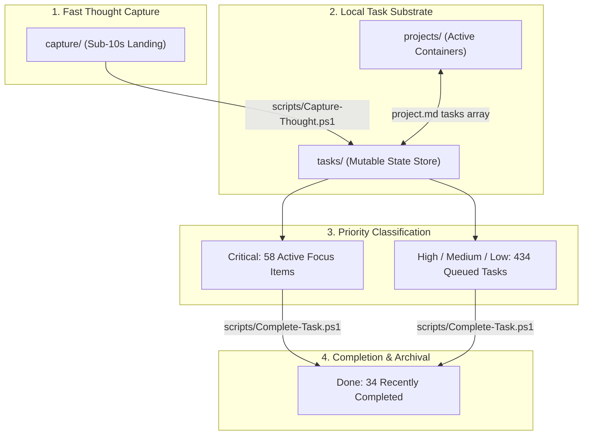

# AIOS Master Task Register & Action Dashboard

**Generated:** 2026-11-10 21:36:48 | **Authoritative State:** Local AIOS Task Substrate
**Scope:** Universal Master Task & Action Register across [`Leonidas AIOS`](.) and `SimplyGersi AIOS` (ADR-0025)

---

## 1. Executive Priority Radar

| Priority Tier                       | Leonidas AIOS (Personal / Substrate) | SimplyGersi AIOS (Business Domain) | Total Active   |
| ----------------------------------- | ------------------------------------ | ---------------------------------- | -------------- |
| 🔴 **Critical** (Immediate Focus)   | 9 active                             | 49 active                          | 58 actions     |
| 🟡 **High / Medium / Low** (Queued) | 354 active                           | 80 active                          | 434 actions    |
| 🟢 **Done** (Retained <=14 days)    | 34 verified                          | -                                  | 34 completions |

---

## 2. 🔴 NOW: Immediate Actions & Active Sprint Focus

These tasks represent active sprint focus, immediate operational blockers, or uncommitted debt.

### Active Sprint Tasks

| Status          | Task Name                                                                                 | Scope      | Milestone | Owner    | Done When | Project        | File                                                                                                                                                                                         |
| --------------- | ----------------------------------------------------------------------------------------- | ---------- | --------- | -------- | --------- | -------------- | -------------------------------------------------------------------------------------------------------------------------------------------------------------------------------------------- |
| Awaiting Review | Chart and ship the Leonidas 1.0 feature wave                                              | structural | Ops       | leonidas | -         | `leonidas-app` | [`chart-and-ship-the-leonidas-10-feature-wave.md`](./tasks/chart-and-ship-the-leonidas-10-feature-wave.md)                                                                                   |
| Awaiting Review | Get the SimplyGersi AIOS ready and Gersi on the Leonidas app                              | structural | Ops       | leonidas | 2/5       | `leonidas-app` | [`get-the-simplygersi-aios-ready-and-gersi-on-the-leonidas-app.md`](./tasks/get-the-simplygersi-aios-ready-and-gersi-on-the-leonidas-app.md)                                                 |
| Awaiting Review | Port the Scribe dictation pages into Leonidas tabs                                        | structural | Ops       | leonidas | 4/10      | `leonidas-app` | [`port-the-scribe-dictation-pages-into-leonidas-tabs.md`](./tasks/port-the-scribe-dictation-pages-into-leonidas-tabs.md)                                                                     |
| Not started     | Publish V1.0 and verify delivery                                                          | structural | 1.0.0     | leonidas | 0/3       | `leonidas-app` | [`publish-v1-0-and-verify-delivery.md`](./tasks/publish-v1-0-and-verify-delivery.md)                                                                                                         |
| Not started     | Resolve launch acceptance and obtain owner sign-off                                       | structural | 1.0.0     | leonidas | 0/3       | `leonidas-app` | [`resolve-launch-acceptance-and-obtain-owner-sign-off.md`](./tasks/resolve-launch-acceptance-and-obtain-owner-sign-off.md)                                                                   |
| Not started     | Run the 14-day Leonidas feasibility review                                                | personal   | Ops       | leonidas | 0/4       | `leonidas-app` | [`run-the-14-day-leonidas-feasibility-review.md`](./tasks/run-the-14-day-leonidas-feasibility-review.md)                                                                                     |
| Not started     | Run the five-user private beginner test                                                   | personal   | Ops       | leonidas | 0/4       | `leonidas-app` | [`run-the-five-user-private-beginner-test.md`](./tasks/run-the-five-user-private-beginner-test.md)                                                                                           |
| Awaiting Review | Run the Leonidas 1.0 beta program with per-user tracking and feedback                     | structural | Ops       | leonidas | 0/4       | `leonidas-app` | [`run-the-leonidas-10-beta-program-with-per-user-tracking-and-feedback.md`](./tasks/run-the-leonidas-10-beta-program-with-per-user-tracking-and-feedback.md)                                 |
| Awaiting Review | Spec: wave Lane A, voice onboarding, beginner undo, own-your-brain line, template privacy | structural | Ops       | leonidas | 12/15     | `leonidas-app` | [`spec-wave-lane-a-voice-onboarding-beginner-undo-own-your-brain-line-template-privacy.md`](./tasks/spec-wave-lane-a-voice-onboarding-beginner-undo-own-your-brain-line-template-privacy.md) |

### Live Sprint Execution Checklists

#### 1. Chart and ship the Leonidas 1.0 feature wave ([`chart-and-ship-the-leonidas-10-feature-wave.md`](./tasks/chart-and-ship-the-leonidas-10-feature-wave.md))

Tag: wayfinder:map. Grill capture: [2026-10-19 session](./logs/grill-sessions/2026-10-19-leonidas-feature-wave-map.md). Lane prompts: [`handoff-docs/2026-10-19-feature-wave-lane-prompts.md`](./handoff-docs/2026-10-19-feature-wave-lane-prompts.md).

- _No explicit Done when checkboxes defined._

#### 2. Get the SimplyGersi AIOS ready and Gersi on the Leonidas app ([`get-the-simplygersi-aios-ready-and-gersi-on-the-leonidas-app.md`](./tasks/get-the-simplygersi-aios-ready-and-gersi-on-the-leonidas-app.md))

Source: logs/grill-sessions/2026-10-17-priorities-and-horizon-plan.md

SimplyGersi restarts 2026-10-18. The SimplyGersi AIOS has 183 uncommitted changes and 4 unpushed commits, ONBOARDING points Gersi to Claude Code or Antigravity and a wrong clone URL (ItzJsimp/simplygersi, remote is simplygersi-aios), business memory dates from 2026-08-20, and no Gersi identity file exists. Writes in the peer repo need Jake's explicit confirmation (ADR-0008). Gersi is beta user 1 for a non-builder: log every stuck point as a leonidas-product card.

- [x] The SimplyGersi working tree is reviewed, committed in scoped commits and pushed (Jake confirms)
- [x] ONBOARDING tells Gersi to install Leonidas-Setup.exe and clone ItzJsimp/simplygersi-aios
- [ ] Gersi opens the SimplyGersi AIOS in the Leonidas app and gets a correct answer about a past deal
- [ ] Each stuck point from Gersi's setup is a task card
- [ ] The 2026-10-18 call is recorded in calls/ with the video target and the win-back list

#### 3. Port the Scribe dictation pages into Leonidas tabs ([`port-the-scribe-dictation-pages-into-leonidas-tabs.md`](./tasks/port-the-scribe-dictation-pages-into-leonidas-tabs.md))

Parent: projects/leonidas-product/plan.md (Execution, unify push 2026-10-17). ADR-0074 governs the engine.

Every Python Qt dictation page (home, transcripts, dictionary, voice, goals, insights, copy, settings) gets a React tab in the Leonidas app, driven only through the engine contract (v1.1 adds the read endpoints the spec names). Meetings has its own card (build-the-react-meetings-tab-in-leonidas-code).

- [ ] Each page listed in the port spec renders as a tab with empty, loading and error states
- [ ] Tabs read data only through contract endpoints or events, with a mock engine in tests
- [ ] pnpm --dir projects/leonidas-app typecheck exits 0
- [ ] performance-gate verdict recorded

#### 4. Publish V1.0 and verify delivery ([`publish-v1-0-and-verify-delivery.md`](./tasks/publish-v1-0-and-verify-delivery.md))

## Goal

After launch-signoff only, invoke the approved launch workflow. Verify installer, blockmap and latest.yml correspond to the same source commit; confirm clean install and update on isolated devices.

- [ ] Approved V1.0 artifacts verified; installed app shows correct history; rollback/recovery instructions work.
- [ ] Report changed files, scoped checks and remaining limitations; preserve unrelated work.
- [ ] `performance-gate` verdict, with before and after numbers, is recorded in this card.

#### 5. Resolve launch acceptance and obtain owner sign-off ([`resolve-launch-acceptance-and-obtain-owner-sign-off.md`](./tasks/resolve-launch-acceptance-and-obtain-owner-sign-off.md))

## Goal

Summarize candidate evidence and remaining limitations for Jake and Mob. Require explicit approval for public launch; milestone completion alone cannot publish.

- [ ] Owner approval recorded; every release-blocking task done; deferred scope and known limitations stated.
- [ ] Report changed files, scoped checks and remaining limitations; preserve unrelated work.
- [ ] `performance-gate` verdict, with before and after numbers, is recorded in this card.

#### 6. Run the 14-day Leonidas feasibility review ([`run-the-14-day-leonidas-feasibility-review.md`](./tasks/run-the-14-day-leonidas-feasibility-review.md))

Within 14 days of plan approval. Source: logs/grill-sessions/2026-10-13-leonidas-unified-app-business.md (Q19, Q20, Q35). Planning ceiling is not permission to spend.

- [ ] The review is done within 14 days of plan approval, and its date is recorded here.
- [ ] The review answers Q19, Q20 and Q35 from the 2026-10-13 grill session.
- [ ] No money is spent without Jake's separate approval.
- [ ] Card status is Done, with a dated close note that names the checks that ran.

#### 7. Run the five-user private beginner test ([`run-the-five-user-private-beginner-test.md`](./tasks/run-the-five-user-private-beginner-test.md))

Clock starts at first app launch; install and new-provider signup measured separately. Gate before any livestream or promotion (Q8, Q10). Source: logs/grill-sessions/2026-10-13-leonidas-unified-app-business.md.

- [ ] 5 beginner users finish the test; time is measured from first app launch.
- [ ] Install time and new-provider signup time are recorded separately.
- [ ] The result is recorded before any livestream or promotion (Q8, Q10).
- [ ] Card status is Done, with a dated close note that names the checks that ran.

#### 8. Run the Leonidas 1.0 beta program with per-user tracking and feedback ([`run-the-leonidas-10-beta-program-with-per-user-tracking-and-feedback.md`](./tasks/run-the-leonidas-10-beta-program-with-per-user-tracking-and-feedback.md))

## Why

Jake decided on 2026-10-19: 1.0 on 2026-11-15 ships free to the beta roster (Mob, Shake, Josh, Justine, Gavin, Bird, Gersi). Paid checkout opens later, after merchant, terms, licensing and Mob sign-off. About 80% of these users are new to AI, so they are the test for "simple enough for anyone". Jake wants each person tracked and their feedback turned into fixes.

- [ ] `beta-roster.md` has one row per beta user with contact card, install date, app version, first-run minutes and usage consent (yes, no or not asked); no Unknown cells remain in those five columns. The Scribe, AIOS and What they build columns are optional notes (Jake, 2026-10-19: names are enough).
- [ ] The PostHog EU project shows the beta cohort's install count, setup step reached and 3-day return; no name is linked to an install ID.
- [ ] Each stuck point a beta user reports becomes a `project: leonidas-product` task card within 24 hours.
- [ ] First-run time from first launch is recorded for at least 5 users new to AI (feeds `run-the-five-user-private-beginner-test`).

#### 9. Spec: wave Lane A, voice onboarding, beginner undo, own-your-brain line, template privacy ([`spec-wave-lane-a-voice-onboarding-beginner-undo-own-your-brain-line-template-privacy.md`](./tasks/spec-wave-lane-a-voice-onboarding-beginner-undo-own-your-brain-line-template-privacy.md))

Map: `chart-and-ship-the-leonidas-10-feature-wave`. Code: `projects/leonidas-app`, worktree `C:/lcw/wave-a`, branch `wave/a` from origin/main 375fbe9eca.

- _No explicit Done when checkboxes defined._

---

## 3. 🟡 NEXT: Active Sprints by Milestone

Tasks scheduled across active milestones defined in [`BUILD-PLAN.md`](./BUILD-PLAN.md) and system maintenance workflows.

### A. M1: Substrate & Core Infrastructure

_No active tasks currently queued in this milestone._

### B. M2: SimplyGersi Orchestrator & Tooling

_No active tasks currently queued in this milestone._

### C. M3: Guardrails, Quality & Telemetry

_No active tasks currently queued in this milestone._

### D. M4: Personal Brain Harvest & Knowledge

_No active tasks currently queued in this milestone._

### E. Ops: Operational Workflows & Maintenance

| Status          | Task Name                                                                                                                                | Scope      | Owner    | Done When | Project        | File                                                                                                                                                                                                                                                                             |
| --------------- | ---------------------------------------------------------------------------------------------------------------------------------------- | ---------- | -------- | --------- | -------------- | -------------------------------------------------------------------------------------------------------------------------------------------------------------------------------------------------------------------------------------------------------------------------------- |
| Not started     | 02 Revenue launch the one-page site                                                                                                      | structural | leonidas | 0/6       | `leonidas-app` | [`02-revenue-launch-the-one-page-site.md`](./tasks/02-revenue-launch-the-one-page-site.md)                                                                                                                                                                                       |
| Not started     | 03 Revenue make the daily X draft queue                                                                                                  | structural | leonidas | 0/4       | `leonidas-app` | [`03-revenue-make-the-daily-x-draft-queue.md`](./tasks/03-revenue-make-the-daily-x-draft-queue.md)                                                                                                                                                                               |
| Not started     | 04 Revenue write the session playbook for both tiers                                                                                     | structural | leonidas | 0/4       | `leonidas-app` | [`04-revenue-write-the-session-playbook-for-both-tiers.md`](./tasks/04-revenue-write-the-session-playbook-for-both-tiers.md)                                                                                                                                                     |
| Not started     | 08 Revenue start the brand account and scheduled posts                                                                                   | structural | leonidas | 0/4       | `leonidas-app` | [`08-revenue-start-the-brand-account-and-scheduled-posts.md`](./tasks/08-revenue-start-the-brand-account-and-scheduled-posts.md)                                                                                                                                                 |
| Not started     | Add a cheap screenshot workflow for release stories                                                                                      | structural | leonidas | 0/2       | `leonidas-app` | [`add-a-cheap-screenshot-workflow-for-release-stories.md`](./tasks/add-a-cheap-screenshot-workflow-for-release-stories.md)                                                                                                                                                       |
| Awaiting Review | Add a dictation mic to key text fields and hide it during questions                                                                      | structural | leonidas | 7/7       | `leonidas-app` | [`add-a-dictation-mic-to-key-text-fields-and-hide-it-during-questions.md`](./tasks/add-a-dictation-mic-to-key-text-fields-and-hide-it-during-questions.md)                                                                                                                       |
| Not started     | Add a Remove option to the project picker                                                                                                | structural | leonidas | -         | `leonidas-app` | [`add-a-remove-option-to-the-project-picker.md`](./tasks/add-a-remove-option-to-the-project-picker.md)                                                                                                                                                                           |
| Dormant         | Add a same-error retry budget that escalates delegated tasks                                                                             | structural | leonidas | 0/4       | `leonidas-app` | [`add-a-same-error-retry-budget-that-escalates-delegated-tasks.md`](./tasks/add-a-same-error-retry-budget-that-escalates-delegated-tasks.md)                                                                                                                                     |
| Awaiting Review | Add a snip tool with window auto-detect to the Leonidas composer                                                                         | structural | leonidas | 7/12      | `leonidas-app` | [`add-a-snip-tool-with-window-auto-detect-to-the-leonidas-code-composer.md`](./tasks/add-a-snip-tool-with-window-auto-detect-to-the-leonidas-code-composer.md)                                                                                                                   |
| Not started     | Add a stable release channel and PR checks before the 1.0 launch                                                                         | structural | leonidas | 0/7       | `leonidas-app` | [`add-a-stable-release-channel-and-pr-checks-before-the-10-launch.md`](./tasks/add-a-stable-release-channel-and-pr-checks-before-the-10-launch.md)                                                                                                                               |
| Awaiting Review | Add an interim SmartScreen guide next to the installer download                                                                          | structural | leonidas | 0/4       | `leonidas-app` | [`add-an-interim-smartscreen-guide-next-to-the-installer-download.md`](./tasks/add-an-interim-smartscreen-guide-next-to-the-installer-download.md)                                                                                                                               |
| Not started     | Add brand.json runtime white-label and an onboarding look-and-feel round ⚠️ **stale 32d**                                                | personal   | leonidas | 0/3       | `leonidas-app` | [`add-brandjson-runtime-white-label-and-an-onboarding-look-and-feel-round.md`](./tasks/add-brandjson-runtime-white-label-and-an-onboarding-look-and-feel-round.md)                                                                                                               |
| Dormant         | Add Claude orchestration v2 provider-switch and context-transfer test fixtures                                                           | structural | leonidas | 0/3       | `leonidas-app` | [`add-claude-orchestration-v2-provider-switch-and-context-transfer-test-fixtures.md`](./tasks/add-claude-orchestration-v2-provider-switch-and-context-transfer-test-fixtures.md)                                                                                                 |
| Not started     | Add dedicated transform_polish_provider and model configuration and route transform calls through it ⚠️ **stale 36d**                    | structural | leonidas | 0/3       | `leonidas-app` | [`add-dedicated-transformpolishprovider-and-model-configuration-and-route-transform-calls-through-it.md`](./tasks/add-dedicated-transformpolishprovider-and-model-configuration-and-route-transform-calls-through-it.md)                                                         |
| Not started     | Add delta lines to Command Center number tiles from a daily count history                                                                | structural | leonidas | 0/4       | `leonidas-app` | [`add-delta-lines-to-command-center-number-tiles-from-a-daily-count-history.md`](./tasks/add-delta-lines-to-command-center-number-tiles-from-a-daily-count-history.md)                                                                                                           |
| Dormant         | Add Dictate shortcut to Leonidas keybindings                                                                                             | structural | leonidas | -         | `leonidas-app` | [`add-dictate-shortcut-to-leonidas-code-keybindings.md`](./tasks/add-dictate-shortcut-to-leonidas-code-keybindings.md)                                                                                                                                                           |
| Awaiting Review | Add dictation setup to the first-run wizard                                                                                              | structural | leonidas | 0/3       | `leonidas-app` | [`add-dictation-setup-to-the-first-run-wizard.md`](./tasks/add-dictation-setup-to-the-first-run-wizard.md)                                                                                                                                                                       |
| Dormant         | Add embedded PTY terminals and named sessions to Command Center ⚠️ **stale 45d**                                                         | structural | leonidas | 3/4       | `leonidas-app` | [`add-embedded-pty-terminals-and-named-sessions-to-command-center.md`](./tasks/add-embedded-pty-terminals-and-named-sessions-to-command-center.md)                                                                                                                               |
| Awaiting Review | Add handoff prompts to the Sweep threads dialog                                                                                          | structural | leonidas | 0/4       | `leonidas-app` | [`add-handoff-prompts-to-the-sweep-threads-dialog.md`](./tasks/add-handoff-prompts-to-the-sweep-threads-dialog.md)                                                                                                                                                               |
| Dormant         | Add Ollama and llama.cpp local provider with SSD model storage                                                                           | structural | leonidas | 0/3       | `leonidas-app` | [`add-ollama-and-llamacpp-local-provider-with-ssd-model-storage.md`](./tasks/add-ollama-and-llamacpp-local-provider-with-ssd-model-storage.md)                                                                                                                                   |
| Awaiting Review | Add skill matching rewrite preset to Scribe                                                                                              | structural | leonidas | 4/5       | `leonidas-app` | [`add-skill-matching-rewrite-preset-to-scribe.md`](./tasks/add-skill-matching-rewrite-preset-to-scribe.md)                                                                                                                                                                       |
| Awaiting Review | Add the per-release benchmark report and the Electron budget gate                                                                        | structural | leonidas | 3/4       | `leonidas-app` | [`add-the-per-release-benchmark-report-and-the-electron-budget-gate.md`](./tasks/add-the-per-release-benchmark-report-and-the-electron-budget-gate.md)                                                                                                                           |
| Awaiting Review | Add the Scribe rewrite hotkey with a preset picker, built-in words, and the Goals and Insights tabs                                      | structural | leonidas | 10/12     | `leonidas-app` | [`add-the-scribe-rewrite-hotkey-with-a-preset-picker-built-in-words-and-the-goals-and-insights-tabs.md`](./tasks/add-the-scribe-rewrite-hotkey-with-a-preset-picker-built-in-words-and-the-goals-and-insights-tabs.md)                                                           |
| Dormant         | Add Windows performance advisor for local models                                                                                         | structural | leonidas | 0/3       | `leonidas-app` | [`add-windows-performance-advisor-for-local-models.md`](./tasks/add-windows-performance-advisor-for-local-models.md)                                                                                                                                                             |
| Dormant         | Add winning local image models to Leonidas Images                                                                                        | structural | leonidas | 0/5       | `leonidas-app` | [`add-winning-local-image-models-to-leonidas-code-images.md`](./tasks/add-winning-local-image-models-to-leonidas-code-images.md)                                                                                                                                                 |
| Not started     | Adopt Leonidas vector mark as small-size icon source and brand canon ⚠️ **stale 45d**                                                    | structural | leonidas | 0/4       | `leonidas-app` | [`adopt-leonidas-vector-mark-as-small-size-icon-source-and-brand-canon.md`](./tasks/adopt-leonidas-vector-mark-as-small-size-icon-source-and-brand-canon.md)                                                                                                                     |
| Dormant         | AIOS project template and one-click scaffolder in the Leonidas app                                                                       | structural | leonidas | 0/4       | `leonidas-app` | [`aios-project-template-scaffolder.md`](./tasks/aios-project-template-scaffolder.md)                                                                                                                                                                                             |
| Awaiting Review | Approve and verify the AIOS identity link in the T3 repo, then roll it out to Mob                                                        | personal   | leonidas | 1/3       | `leonidas-app` | [`approve-and-verify-the-aios-identity-link-in-the-t3-repo-then-roll-it-out-to-mob.md`](./tasks/approve-and-verify-the-aios-identity-link-in-the-t3-repo-then-roll-it-out-to-mob.md)                                                                                             |
| Not started     | Approve the GitHub release rewrite (Gate 2)                                                                                              | structural | leonidas | 0/2       | `leonidas-app` | [`approve-the-github-release-rewrite-gate-2.md`](./tasks/approve-the-github-release-rewrite-gate-2.md)                                                                                                                                                                           |
| Awaiting Review | Archive, snooze and delete Leonidas chats by touch with long-press menu and swipe to archive                                             | structural | leonidas | 7/12      | `leonidas-app` | [`archive-snooze-and-delete-leonidas-code-chats-by-touch-with-long-press-menu-and-swipe-to-archive.md`](./tasks/archive-snooze-and-delete-leonidas-code-chats-by-touch-with-long-press-menu-and-swipe-to-archive.md)                                                             |
| Dormant         | Ask at setup to pin Leonidas to the taskbar or desktop                                                                                   | personal   | leonidas | -         | `leonidas-app` | [`ask-at-setup-to-pin-leonidas-code-to-the-taskbar-or-desktop.md`](./tasks/ask-at-setup-to-pin-leonidas-code-to-the-taskbar-or-desktop.md)                                                                                                                                       |
| Dormant         | Audit the AI Desktop button: explain it and decide keep or cut                                                                           | personal   | leonidas | -         | `leonidas-app` | [`audit-the-ai-desktop-button-explain-it-and-decide-keep-or-cut.md`](./tasks/audit-the-ai-desktop-button-explain-it-and-decide-keep-or-cut.md)                                                                                                                                   |
| Dormant         | Bring the agent work surface to the front and add a where-is-it-working chip                                                             | structural | leonidas | -         | `leonidas-app` | [`bring-the-agent-work-surface-to-the-front-and-add-a-where-is-it-working-chip.md`](./tasks/bring-the-agent-work-surface-to-the-front-and-add-a-where-is-it-working-chip.md)                                                                                                     |
| Not started     | Build a Git dashboard in Leonidas for all repos, branches and worktrees                                                                  | structural | leonidas | 0/7       | `leonidas-app` | [`build-a-git-dashboard-in-leonidas-code-for-all-repos-branches-and-worktrees.md`](./tasks/build-a-git-dashboard-in-leonidas-code-for-all-repos-branches-and-worktrees.md)                                                                                                       |
| Not started     | Build a Remote Control tab with Sunshine and Moonlight                                                                                   | structural | leonidas | -         | `leonidas-app` | [`build-a-remote-control-tab-with-sunshine-and-moonlight.md`](./tasks/build-a-remote-control-tab-with-sunshine-and-moonlight.md)                                                                                                                                                 |
| Dormant         | Build an agent that ports new upstream T3 Code updates into Leonidas without breaking anything                                           | structural | leonidas | 0/5       | `leonidas-app` | [`build-an-agent-that-ports-new-upstream-t3-code-updates-into-leonidas-code-without-breaking-anything.md`](./tasks/build-an-agent-that-ports-new-upstream-t3-code-updates-into-leonidas-code-without-breaking-anything.md)                                                       |
| Awaiting Review | Build and test the Rust Scribe engine on macOS                                                                                           | structural | leonidas | 0/4       | `leonidas-app` | [`build-and-test-the-rust-scribe-engine-on-macos.md`](./tasks/build-and-test-the-rust-scribe-engine-on-macos.md)                                                                                                                                                                 |
| Dormant         | Build delegation ledger, task checks and routing suggestions                                                                             | structural | leonidas | 0/3       | `leonidas-app` | [`build-delegation-ledger-task-checks-and-routing-suggestions.md`](./tasks/build-delegation-ledger-task-checks-and-routing-suggestions.md)                                                                                                                                       |
| Dormant         | Build the app-flows eval set (report-only baseline)                                                                                      | structural | leonidas | 0/3       | `leonidas-app` | [`build-eval-set-for-app-flows-report-only.md`](./tasks/build-eval-set-for-app-flows-report-only.md)                                                                                                                                                                             |
| Dormant         | Build image generation as a feature inside Leonidas                                                                                      | structural | leonidas | 0/5       | `leonidas-app` | [`build-image-generation-as-a-feature-inside-leonidas-code.md`](./tasks/build-image-generation-as-a-feature-inside-leonidas-code.md)                                                                                                                                             |
| Dormant         | Build Leonidas AI app badge and notification icon assets from avatar recipe ⚠️ **stale 39d**                                             | structural | leonidas | 0/4       | `leonidas-app` | [`build-leonidas-ai-app-badge-and-notification-icon-assets-from-avatar-recipe.md`](./tasks/build-leonidas-ai-app-badge-and-notification-icon-assets-from-avatar-recipe.md)                                                                                                       |
| Awaiting Review | Build Leonidas Memory: per-AIOS SQLite index served by the app MCP                                                                       | structural | leonidas | 6/13      | `leonidas-app` | [`build-leonidas-memory-per-aios-sqlite-index-served-by-the-app-mcp.md`](./tasks/build-leonidas-memory-per-aios-sqlite-index-served-by-the-app-mcp.md)                                                                                                                           |
| Dormant         | Build Scribe Meetings: meeting recorder, transcription, speakers and notes ⚠️ **stale 32d**                                              | personal   | leonidas | 14/17     | `leonidas-app` | [`build-meeting-transcription-pipeline.md`](./tasks/build-meeting-transcription-pipeline.md)                                                                                                                                                                                     |
| Dormant         | Build shadow compare with blind A B and agent replay                                                                                     | structural | leonidas | 0/3       | `leonidas-app` | [`build-shadow-compare-with-blind-a-b-and-agent-replay.md`](./tasks/build-shadow-compare-with-blind-a-b-and-agent-replay.md)                                                                                                                                                     |
| Dormant         | Redesign Command Center Memories tab: transparent curation, overlap detection, and clear review UI ⚠️ **stale 36d**                      | structural | leonidas | 0/6       | `leonidas-app` | [`build-the-command-center-memories-tab-from-the-2026-09-26-grill-synthesis.md`](./tasks/build-the-command-center-memories-tab-from-the-2026-09-26-grill-synthesis.md)                                                                                                           |
| Awaiting Review | Build the Content lens for SimplyGersi deals                                                                                             | structural | leonidas | 19/28     | `leonidas-app` | [`build-the-content-lens-for-simplygersi-deals.md`](./tasks/build-the-content-lens-for-simplygersi-deals.md)                                                                                                                                                                     |
| Awaiting Review | Build the curated library and managed copies for skills rules and packs                                                                  | structural | leonidas | 9/14      | `leonidas-app` | [`build-the-curated-library-and-managed-copies-for-skills-rules-and-packs.md`](./tasks/build-the-curated-library-and-managed-copies-for-skills-rules-and-packs.md)                                                                                                               |
| Not started     | Build the daily briefing takeover                                                                                                        | structural | leonidas | 0/6       | `leonidas-app` | [`build-the-daily-briefing-takeover.md`](./tasks/build-the-daily-briefing-takeover.md)                                                                                                                                                                                           |
| Not started     | Build the Discord connector for marketing drafts and approved posts                                                                      | structural | leonidas | 0/3       | `leonidas-app` | [`build-the-discord-connector-for-marketing-drafts-and-approved-posts.md`](./tasks/build-the-discord-connector-for-marketing-drafts-and-approved-posts.md)                                                                                                                       |
| Not started     | Build the hook catalog and install it per engine                                                                                         | structural | leonidas | 0/6       | `leonidas-app` | [`build-the-hook-catalog-and-install-it-per-engine.md`](./tasks/build-the-hook-catalog-and-install-it-per-engine.md)                                                                                                                                                             |
| Dormant         | Build the Leonidas landing page and license checkout ⚠️ **stale 32d**                                                                    | personal   | leonidas | 0/4       | `leonidas-app` | [`build-the-leonidas-landing-page-and-license-checkout.md`](./tasks/build-the-leonidas-landing-page-and-license-checkout.md)                                                                                                                                                     |
| Awaiting Review | Build the Leonidas shell from the T3 fork with the Command Center as a tab                                                               | personal   | leonidas | 0/6       | `leonidas-app` | [`build-the-leonidas-shell-from-the-t3-fork-with-the-command-center-as-a-tab.md`](./tasks/build-the-leonidas-shell-from-the-t3-fork-with-the-command-center-as-a-tab.md)                                                                                                         |
| Not started     | Build the marketing email send path with unsubscribe and approval                                                                        | structural | leonidas | 0/3       | `leonidas-app` | [`build-the-marketing-email-send-path-with-unsubscribe-and-approval.md`](./tasks/build-the-marketing-email-send-path-with-unsubscribe-and-approval.md)                                                                                                                           |
| Dormant         | Build the mod-builder skill and the mod_check tool                                                                                       | structural | leonidas | 0/4       | `leonidas-app` | [`build-the-mod-builder-skill-and-the-modcheck-tool.md`](./tasks/build-the-mod-builder-skill-and-the-modcheck-tool.md)                                                                                                                                                           |
| Dormant         | Build the mod host on the Command Center                                                                                                 | structural | leonidas | 0/7       | `leonidas-app` | [`build-the-mod-host-on-the-command-center.md`](./tasks/build-the-mod-host-on-the-command-center.md)                                                                                                                                                                             |
| Awaiting Review | Build the org kit screens: Team view, member and role editor, invite and first open                                                      | structural | leonidas | 2/6       | `leonidas-app` | [`build-the-org-kit-screens-team-view-member-and-role-editor-invite-and-first-open.md`](./tasks/build-the-org-kit-screens-team-view-member-and-role-editor-invite-and-first-open.md)                                                                                             |
| Dormant         | Build the React Meetings tab in Leonidas                                                                                                 | structural | leonidas | 0/3       | `leonidas-app` | [`build-the-react-meetings-tab-in-leonidas-code.md`](./tasks/build-the-react-meetings-tab-in-leonidas-code.md)                                                                                                                                                                   |
| Awaiting Review | Build the Sweep threads dialog with batch archive                                                                                        | structural | leonidas | 0/5       | `leonidas-app` | [`build-the-sweep-threads-dialog-with-batch-archive.md`](./tasks/build-the-sweep-threads-dialog-with-batch-archive.md)                                                                                                                                                           |
| Awaiting Review | Build the task reconciler: live chat presence and per-chat history on cards                                                              | structural | leonidas | 7/13      | `leonidas-app` | [`build-the-task-reconciler-live-chat-presence-and-per-chat-history-on-cards.md`](./tasks/build-the-task-reconciler-live-chat-presence-and-per-chat-history-on-cards.md)                                                                                                         |
| Awaiting Review | Build the thread sweep dialog for Leonidas                                                                                               | structural | leonidas | 3/10      | `leonidas-app` | [`build-the-thread-sweep-dialog-for-leonidas-code.md`](./tasks/build-the-thread-sweep-dialog-for-leonidas-code.md)                                                                                                                                                               |
| Awaiting Review | Build the two-state layout and the slot registry for 1.0                                                                                 | structural | leonidas | 6/12      | `leonidas-app` | [`build-the-two-state-layout-and-the-slot-registry-for-10.md`](./tasks/build-the-two-state-layout-and-the-slot-registry-for-10.md)                                                                                                                                               |
| Not started     | Build the X publish path behind approval tickets spend caps and the kill switch                                                          | structural | leonidas | 0/5       | `leonidas-app` | [`build-the-x-publish-path-behind-approval-tickets-spend-caps-and-the-kill-switch.md`](./tasks/build-the-x-publish-path-behind-approval-tickets-spend-caps-and-the-kill-switch.md)                                                                                               |
| Not started     | Chart the Leonidas app vision v2 into buildable 1.0 cards                                                                                | structural | leonidas | -         | `leonidas-app` | [`chart-the-leonidas-app-vision-v2-into-buildable-10-cards.md`](./tasks/chart-the-leonidas-app-vision-v2-into-buildable-10-cards.md)                                                                                                                                             |
| Not started     | Chart the Leonidas content pipeline for SimplyGersi deals                                                                                | structural | leonidas | -         | `leonidas-app` | [`chart-the-leonidas-content-pipeline-for-simplygersi-deals.md`](./tasks/chart-the-leonidas-content-pipeline-for-simplygersi-deals.md)                                                                                                                                           |
| Awaiting Review | Chart the Leonidas marketing system                                                                                                      | structural | leonidas | -         | `leonidas-app` | [`chart-the-leonidas-marketing-system.md`](./tasks/chart-the-leonidas-marketing-system.md)                                                                                                                                                                                       |
| Dormant         | Clean the Goo player analytics in Command Center via Roblox Open Cloud                                                                   | structural | leonidas | 0/3       | `leonidas-app` | [`clean-the-goo-player-analytics-in-command-center-via-roblox-open-cloud.md`](./tasks/clean-the-goo-player-analytics-in-command-center-via-roblox-open-cloud.md)                                                                                                                 |
| Not started     | Clear the Leonidas check failures found on origin/main                                                                                   | structural | leonidas | 0/4       | `leonidas-app` | [`clear-the-leonidas-code-check-failures-found-on-originmain.md`](./tasks/clear-the-leonidas-code-check-failures-found-on-originmain.md)                                                                                                                                         |
| Not started     | Clear the vp lint errors in Leonidas scripts outside the diagnostics fix                                                                 | structural | leonidas | 0/3       | `leonidas-app` | [`clear-the-vp-lint-errors-in-leonidas-code-scripts-outside-the-diagnostics-fix.md`](./tasks/clear-the-vp-lint-errors-in-leonidas-code-scripts-outside-the-diagnostics-fix.md)                                                                                                   |
| Dormant         | Collapse chat list by date group (Today, Yesterday)                                                                                      | personal   | leonidas | -         | `leonidas-app` | [`collapse-chat-list-by-date-group-today-yesterday.md`](./tasks/collapse-chat-list-by-date-group-today-yesterday.md)                                                                                                                                                             |
| Dormant         | Command Center: Activity tab with day summary, work vs not-work rules, and time per project ⚠️ **stale 36d**                             | structural | leonidas | 0/4       | `leonidas-app` | [`command-center-activity-tab-day-work-rules-and-time-per-project.md`](./tasks/command-center-activity-tab-day-work-rules-and-time-per-project.md)                                                                                                                               |
| Dormant         | Command Center Phase 1: Claude Design prototype and design system ⚠️ **stale 40d**                                                       | structural | leonidas | 0/3       | `leonidas-app` | [`command-center-phase-1-claude-design-prototype-and-design-system.md`](./tasks/command-center-phase-1-claude-design-prototype-and-design-system.md)                                                                                                                             |
| Dormant         | Command Center Phase 2: build desktop v1 ⚠️ **stale 40d**                                                                                | structural | leonidas | 0/6       | `leonidas-app` | [`command-center-phase-2-build-desktop-v1.md`](./tasks/command-center-phase-2-build-desktop-v1.md)                                                                                                                                                                               |
| Dormant         | Command Center Roblox Games safe actions (tests, open PR, ask Claude) ⚠️ **stale 34d**                                                   | structural | leonidas | 0/3       | `leonidas-app` | [`command-center-roblox-games-safe-actions-tests-open-pr-ask-claude.md`](./tasks/command-center-roblox-games-safe-actions-tests-open-pr-ask-claude.md)                                                                                                                           |
| Dormant         | Command Center: System tab with automations, circuit breakers, freshness badges, tray dot, upgrades queue ⚠️ **stale 45d**               | structural | leonidas | 4/5       | `leonidas-app` | [`command-center-system-tab-automations-circuit-breakers-and-pulse.md`](./tasks/command-center-system-tab-automations-circuit-breakers-and-pulse.md)                                                                                                                             |
| Blocked         | Commit the installed Taste V2 skill in Leonidas after restoring vp                                                                       | structural | leonidas | 0/3       | `leonidas-app` | [`commit-the-installed-taste-v2-skill-in-leonidas-code-after-restoring-vp.md`](./tasks/commit-the-installed-taste-v2-skill-in-leonidas-code-after-restoring-vp.md)                                                                                                               |
| Awaiting Review | Cut Leonidas memory from 6 GB to under 1 GB                                                                                              | structural | leonidas | 7/11      | `leonidas-app` | [`cut-leonidas-code-memory-from-6-gb-to-under-1-gb.md`](./tasks/cut-leonidas-code-memory-from-6-gb-to-under-1-gb.md)                                                                                                                                                             |
| Dormant         | Cut the snip overlay memory peak on multi-display setups                                                                                 | structural | leonidas | 0/3       | `leonidas-app` | [`cut-the-snip-overlay-memory-peak-on-multi-display-setups.md`](./tasks/cut-the-snip-overlay-memory-peak-on-multi-display-setups.md)                                                                                                                                             |
| Not started     | Decide Drive access scope and playback method for the Content lens v1                                                                    | structural | leonidas | 0/3       | `leonidas-app` | [`decide-drive-access-scope-and-playback-method-for-the-content-lens-v1.md`](./tasks/decide-drive-access-scope-and-playback-method-for-the-content-lens-v1.md)                                                                                                                   |
| Not started     | Decide the account rule for unnamed delegated tasks and live-check the new approval card and model list                                  | structural | leonidas | 2/4       | `leonidas-app` | [`decide-the-account-rule-for-unnamed-delegated-tasks-and-live-check-the-new-approval-card-and-model-list.md`](./tasks/decide-the-account-rule-for-unnamed-delegated-tasks-and-live-check-the-new-approval-card-and-model-list.md)                                               |
| Not started     | Decide the remaining ponytail cuts in Leonidas                                                                                           | structural | leonidas | 0/2       | `leonidas-app` | [`decide-the-remaining-ponytail-cuts-in-leonidas-code.md`](./tasks/decide-the-remaining-ponytail-cuts-in-leonidas-code.md)                                                                                                                                                       |
| Dormant         | Decide the X Radar design and build the X feed monitor for Leonidas ⚠️ **stale 31d**                                                     | structural | leonidas | 0/3       | `leonidas-app` | [`decide-the-x-radar-design-and-build-the-x-feed-monitor-for-leonidas-code.md`](./tasks/decide-the-x-radar-design-and-build-the-x-feed-monitor-for-leonidas-code.md)                                                                                                             |
| Not started     | Decide whether native cards obey the open-task cap                                                                                       | structural | leonidas | 0/4       | `leonidas-app` | [`decide-whether-native-cards-obey-the-open-task-cap.md`](./tasks/decide-whether-native-cards-obey-the-open-task-cap.md)                                                                                                                                                         |
| Dormant         | Delete Leonidas D: backup after switch to C:                                                                                             | structural | leonidas | 0/3       | `leonidas-app` | [`delete-leonidas-code-d-backup-after-switch-to-c.md`](./tasks/delete-leonidas-code-d-backup-after-switch-to-c.md)                                                                                                                                                               |
| Dormant         | Design founding-seat allocation and unique-user checks                                                                                   | personal   | leonidas | 0/4       | `leonidas-app` | [`design-founding-seat-allocation-and-unique-user-checks.md`](./tasks/design-founding-seat-allocation-and-unique-user-checks.md)                                                                                                                                                 |
| Dormant         | Design speculative pre-execution engine for Command Center ⚠️ **stale 36d**                                                              | structural | leonidas | 0/5       | `leonidas-app` | [`design-speculative-pre-execution-engine-for-command-center.md`](./tasks/design-speculative-pre-execution-engine-for-command-center.md)                                                                                                                                         |
| Dormant         | Detect hardware and drive types in Leonidas                                                                                              | structural | leonidas | 0/3       | `leonidas-app` | [`detect-hardware-and-drive-types-in-leonidas-code.md`](./tasks/detect-hardware-and-drive-types-in-leonidas-code.md)                                                                                                                                                             |
| Dormant         | Diagnose why the Antigravity probe shows no 5-hour or weekly limits                                                                      | structural | leonidas | 0/3       | `leonidas-app` | [`diagnose-why-the-antigravity-probe-shows-no-5-hour-or-weekly-limits.md`](./tasks/diagnose-why-the-antigravity-probe-shows-no-5-hour-or-weekly-limits.md)                                                                                                                       |
| Awaiting Review | Diagnose why the Leonidas app shows wrong usage and 5-hour or weekly limits                                                              | structural | leonidas | 0/5       | `leonidas-app` | [`diagnose-why-the-leonidas-code-app-shows-wrong-usage-and-5-hour-or-weekly-limits.md`](./tasks/diagnose-why-the-leonidas-code-app-shows-wrong-usage-and-5-hour-or-weekly-limits.md)                                                                                             |
| Awaiting Review | Dictation trigger settings with recorder                                                                                                 | structural | leonidas | 0/3       | `leonidas-app` | [`dictation-trigger-settings-with-recorder.md`](./tasks/dictation-trigger-settings-with-recorder.md)                                                                                                                                                                             |
| Not started     | Discord auto-mute while dictating                                                                                                        | structural | leonidas | 3/10      | `leonidas-app` | [`discord-auto-mute-while-dictating.md`](./tasks/discord-auto-mute-while-dictating.md)                                                                                                                                                                                           |
| Awaiting Review | Discord auto setup when Discord is closed                                                                                                | structural | leonidas | 3/4       | `leonidas-app` | [`discord-auto-setup-when-discord-is-closed.md`](./tasks/discord-auto-setup-when-discord-is-closed.md)                                                                                                                                                                           |
| Awaiting Review | Discord tip and step by step walkthrough                                                                                                 | structural | leonidas | 3/4       | `leonidas-app` | [`discord-tip-and-step-by-step-walkthrough.md`](./tasks/discord-tip-and-step-by-step-walkthrough.md)                                                                                                                                                                             |
| Not started     | Draft and dry-run the release history rewrite                                                                                            | structural | leonidas | 0/3       | `leonidas-app` | [`draft-and-dry-run-the-release-history-rewrite.md`](./tasks/draft-and-dry-run-the-release-history-rewrite.md)                                                                                                                                                                   |
| Not started     | Draft the founder agreement for Mob                                                                                                      | personal   | leonidas | 0/4       | `leonidas-app` | [`draft-the-founder-agreement-for-mob.md`](./tasks/draft-the-founder-agreement-for-mob.md)                                                                                                                                                                                       |
| Dormant         | Enforce a bounded contract schema on delegate_task briefs                                                                                | structural | leonidas | 0/4       | `leonidas-app` | [`enforce-a-bounded-contract-schema-on-delegatetask-briefs.md`](./tasks/enforce-a-bounded-contract-schema-on-delegatetask-briefs.md)                                                                                                                                             |
| Dormant         | Evaluate ABI compatibility and padding for GhosttyTerminalOptions                                                                        | structural | leonidas | 0/3       | `leonidas-app` | [`evaluate-abi-compatibility-and-padding-for-ghosttyterminaloptions.md`](./tasks/evaluate-abi-compatibility-and-padding-for-ghosttyterminaloptions.md)                                                                                                                           |
| Dormant         | Evaluate FreeToken as an optional local model engine                                                                                     | structural | leonidas | -         | `leonidas-app` | [`evaluate-freetoken-as-an-optional-local-model-engine.md`](./tasks/evaluate-freetoken-as-an-optional-local-model-engine.md)                                                                                                                                                     |
| Not started     | Finish or drop the task completion celebration slice on wip/celebration                                                                  | structural | leonidas | 0/1       | `leonidas-app` | [`finish-or-drop-the-task-completion-celebration-slice-on-wipcelebration.md`](./tasks/finish-or-drop-the-task-completion-celebration-slice-on-wipcelebration.md)                                                                                                                 |
| Dormant         | Finish project-scoped next-action ranking and intake rollout                                                                             | structural | leonidas | 0/4       | `leonidas-app` | [`finish-project-scoped-next-action-ranking-and-intake-rollout.md`](./tasks/finish-project-scoped-next-action-ranking-and-intake-rollout.md)                                                                                                                                     |
| Awaiting Review | Finish token audit gates: provider reconciliation, subscription record and visual report                                                 | structural | leonidas | 0/8       | `leonidas-app` | [`finish-token-audit-gates-provider-reconciliation-subscription-record-and-visual-report.md`](./tasks/finish-token-audit-gates-provider-reconciliation-subscription-record-and-visual-report.md)                                                                                 |
| Awaiting Review | First-run fixes: chat drops after Claude install, wizard layout, AIOS default folder, quick interview, background Claude install         | structural | leonidas | -         | `leonidas-app` | [`first-run-fixes-chat-drops-after-claude-install-wizard-layout-aios-default-folder-quick-interview-background-claude-install.md`](./tasks/first-run-fixes-chat-drops-after-claude-install-wizard-layout-aios-default-folder-quick-interview-background-claude-install.md)       |
| Awaiting Review | Fix first-run problems found in 3 recorded setup sessions                                                                                | structural | leonidas | 27/32     | `leonidas-app` | [`fix-first-run-problems-found-in-3-recorded-setup-sessions.md`](./tasks/fix-first-run-problems-found-in-3-recorded-setup-sessions.md)                                                                                                                                           |
| Not started     | Fix Leonidas LC-01 and LC-02: shell check approval and unpinned plugin install                                                           | structural | leonidas | 3/4       | `leonidas-app` | [`fix-leonidas-code-lc-01-and-lc-02-shell-check-approval-and-unpinned-plugin-install.md`](./tasks/fix-leonidas-code-lc-01-and-lc-02-shell-check-approval-and-unpinned-plugin-install.md)                                                                                         |
| Awaiting Review | Fix Leonidas security audit findings 2026-10-19                                                                                          | structural | leonidas | -         | `leonidas-app` | [`fix-leonidas-code-security-audit-findings-2026-10-19.md`](./tasks/fix-leonidas-code-security-audit-findings-2026-10-19.md)                                                                                                                                                     |
| Awaiting Review | Fix Mac auto-update with a fixed self-signed certificate                                                                                 | structural | leonidas | -         | `leonidas-app` | [`fix-mac-auto-update-with-a-fixed-self-signed-certificate.md`](./tasks/fix-mac-auto-update-with-a-fixed-self-signed-certificate.md)                                                                                                                                             |
| Dormant         | Fix prompt prediction not showing in the composer                                                                                        | personal   | leonidas | -         | `leonidas-app` | [`fix-prompt-prediction-not-showing-in-the-composer.md`](./tasks/fix-prompt-prediction-not-showing-in-the-composer.md)                                                                                                                                                           |
| Dormant         | Fix test_call_prompt_record_starts_exactly_one_recording leaving real recorder workers running after pytest                              | structural | leonidas | 0/3       | `leonidas-app` | [`fix-testcallpromptrecordstartsexactlyonerecording-leaving-real-recorder-workers-running-after-pytest.md`](./tasks/fix-testcallpromptrecordstartsexactlyonerecording-leaving-real-recorder-workers-running-after-pytest.md)                                                     |
| Dormant         | Fix the bottom-left Update button icon layer and spacing on panel drag                                                                   | personal   | leonidas | -         | `leonidas-app` | [`fix-the-bottom-left-update-button-icon-layer-and-spacing-on-panel-drag.md`](./tasks/fix-the-bottom-left-update-button-icon-layer-and-spacing-on-panel-drag.md)                                                                                                                 |
| Dormant         | Fix the broken Scribe transform picker and raise preset quality ⚠️ **stale 39d**                                                         | structural | leonidas | 2/4       | `leonidas-app` | [`fix-the-broken-scribe-transform-picker-and-raise-preset-quality.md`](./tasks/fix-the-broken-scribe-transform-picker-and-raise-preset-quality.md)                                                                                                                               |
| Dormant         | Fix the mobile chat header overlap between Goal and AI Desktop controls                                                                  | structural | leonidas | 0/3       | `leonidas-app` | [`fix-the-mobile-chat-header-overlap-between-goal-and-ai-desktop-controls.md`](./tasks/fix-the-mobile-chat-header-overlap-between-goal-and-ai-desktop-controls.md)                                                                                                               |
| Not started     | Fix the pairing screen so a first-time user can connect                                                                                  | structural | leonidas | 0/6       | `leonidas-app` | [`fix-the-pairing-screen-so-a-first-time-user-can-connect.md`](./tasks/fix-the-pairing-screen-so-a-first-time-user-can-connect.md)                                                                                                                                               |
| Dormant         | Fix the perf-agent scheduled task: git fetch origin fails in workspace prep                                                              | personal   | leonidas | -         | `leonidas-app` | [`fix-the-perf-agent-scheduled-task-git-fetch-origin-fails-in-workspace-prep.md`](./tasks/fix-the-perf-agent-scheduled-task-git-fetch-origin-fails-in-workspace-prep.md)                                                                                                         |
| Blocked         | Fix the question card so a typed message never replaces the answer to question 1                                                         | structural | leonidas | 0/4       | `leonidas-app` | [`fix-the-question-card-so-a-typed-message-never-replaces-the-answer-to-question-1.md`](./tasks/fix-the-question-card-so-a-typed-message-never-replaces-the-answer-to-question-1.md)                                                                                             |
| Not started     | Fix the settings nav test for the scheduled tasks page                                                                                   | structural | leonidas | 0/3       | `leonidas-app` | [`fix-the-settings-nav-test-for-the-scheduled-tasks-page.md`](./tasks/fix-the-settings-nav-test-for-the-scheduled-tasks-page.md)                                                                                                                                                 |
| Dormant         | Fix the Tasks window: triage 539 open tasks to the 50 cap and add guards                                                                 | structural | leonidas | 6/13      | `leonidas-app` | [`fix-the-tasks-window-triage-539-open-tasks-to-the-50-cap-and-add-guards.md`](./tasks/fix-the-tasks-window-triage-539-open-tasks-to-the-50-cap-and-add-guards.md)                                                                                                               |
| Not started     | Generate the summary.md numbers table from finance-sync and add waterfall and Needs Jake cards to Finance Overview ⚠️ **stale 45d**      | structural | leonidas | 1/4       | `leonidas-app` | [`generate-the-summarymd-numbers-table-from-finance-sync-and-add-waterfall-and-needs-jake-cards-to-finance-overview.md`](./tasks/generate-the-summarymd-numbers-table-from-finance-sync-and-add-waterfall-and-needs-jake-cards-to-finance-overview.md)                           |
| Not started     | Get Mob to agree on paid-at-1.0 pricing and the scrapped free seats                                                                      | structural | leonidas | 0/2       | `leonidas-app` | [`get-mob-to-agree-on-paid-at-10-pricing-and-the-scrapped-free-seats.md`](./tasks/get-mob-to-agree-on-paid-at-10-pricing-and-the-scrapped-free-seats.md)                                                                                                                         |
| Awaiting Review | Git dashboard slice 1: status lane for every project and the not-on-main banner                                                          | structural | leonidas | 2/10      | `leonidas-app` | [`git-dashboard-slice-1-status-lane-for-every-project-and-the-not-on-main-banner.md`](./tasks/git-dashboard-slice-1-status-lane-for-every-project-and-the-not-on-main-banner.md)                                                                                                 |
| Awaiting Review | Git dashboard slice 2: Save, Send and Get latest from the lane                                                                           | structural | leonidas | 4/10      | `leonidas-app` | [`git-dashboard-slice-2-save-send-and-get-latest-from-the-lane.md`](./tasks/git-dashboard-slice-2-save-send-and-get-latest-from-the-lane.md)                                                                                                                                     |
| Not started     | Give failed feed events a fix button that reruns the failed script                                                                       | structural | leonidas | 0/4       | `leonidas-app` | [`give-failed-feed-events-a-fix-button-that-reruns-the-failed-script.md`](./tasks/give-failed-feed-events-a-fix-button-that-reruns-the-failed-script.md)                                                                                                                         |
| Dormant         | Give Leonidas milestones a name and a number                                                                                             | structural | leonidas | 0/3       | `leonidas-app` | [`give-leonidas-code-milestones-a-name-and-a-number.md`](./tasks/give-leonidas-code-milestones-a-name-and-a-number.md)                                                                                                                                                           |
| Awaiting Review | Give Scribe a public installer download or an honest private-beta notice                                                                 | structural | leonidas | 0/4       | `leonidas-app` | [`give-scribe-a-public-installer-download-or-an-honest-private-beta-notice.md`](./tasks/give-scribe-a-public-installer-download-or-an-honest-private-beta-notice.md)                                                                                                             |
| Awaiting Review | Global trigger runs composer dictation with Discord hold key                                                                             | structural | leonidas | 2/3       | `leonidas-app` | [`global-trigger-runs-composer-dictation-with-discord-hold-key.md`](./tasks/global-trigger-runs-composer-dictation-with-discord-hold-key.md)                                                                                                                                     |
| Not started     | Grant Drive and Docs consent for the SimplyGersi Google gateway                                                                          | structural | leonidas | 0/3       | `leonidas-app` | [`grant-drive-and-docs-consent-for-the-simplygersi-google-gateway.md`](./tasks/grant-drive-and-docs-consent-for-the-simplygersi-google-gateway.md)                                                                                                                               |
| Not started     | Harden Scribe meeting finalize lock edge cases and speed up long-call polish ⚠️ **stale 32d**                                            | structural | leonidas | 0/3       | `leonidas-app` | [`harden-scribe-meeting-finalize-lock-edge-cases-and-speed-up-long-call-polish.md`](./tasks/harden-scribe-meeting-finalize-lock-edge-cases-and-speed-up-long-call-polish.md)                                                                                                     |
| Dormant         | Helper link: share one chat read-only with a mentor who can send tips                                                                    | structural | leonidas | -         | `leonidas-app` | [`helper-link-share-one-chat-read-only-with-a-mentor-who-can-send-tips.md`](./tasks/helper-link-share-one-chat-read-only-with-a-mentor-who-can-send-tips.md)                                                                                                                     |
| Dormant         | Highlight inner panels and buttons in the snip overlay                                                                                   | structural | leonidas | 0/4       | `leonidas-app` | [`highlight-inner-panels-and-buttons-in-the-snip-overlay.md`](./tasks/highlight-inner-panels-and-buttons-in-the-snip-overlay.md)                                                                                                                                                 |
| Dormant         | Implement ADR-0049 Task Velocity AI Depth Telemetry and Command Center Bridge ⚠️ **stale 45d**                                           | structural | leonidas | 4/5       | `leonidas-app` | [`implement-adr-0049-task-velocity-ai-depth-telemetry-and-command-center-bridge.md`](./tasks/implement-adr-0049-task-velocity-ai-depth-telemetry-and-command-center-bridge.md)                                                                                                   |
| Not started     | Implement CopyQ clipboard exclusion ⚠️ **stale 40d**                                                                                     | structural | leonidas | 0/3       | `leonidas-app` | [`implement-copyq-clipboard-exclusion.md`](./tasks/implement-copyq-clipboard-exclusion.md)                                                                                                                                                                                       |
| Dormant         | Implement the Leonidas 56-change performance audit                                                                                       | structural | leonidas | 0/3       | `leonidas-app` | [`implement-the-leonidas-code-56-change-performance-audit.md`](./tasks/implement-the-leonidas-code-56-change-performance-audit.md)                                                                                                                                               |
| Not started     | Implement word-level diff view in Transcripts tab with toggle ⚠️ **stale 40d**                                                           | structural | leonidas | 0/3       | `leonidas-app` | [`implement-word-level-diff-view-in-transcripts-tab-with-toggle.md`](./tasks/implement-word-level-diff-view-in-transcripts-tab-with-toggle.md)                                                                                                                                   |
| Not started     | Inspect generated icon suite and contact sheet for quality at all resolutions                                                            | structural | leonidas | 0/3       | `leonidas-app` | [`inspect-generated-icon-suite-and-contact-sheet-for-quality-at-all-resolutions.md`](./tasks/inspect-generated-icon-suite-and-contact-sheet-for-quality-at-all-resolutions.md)                                                                                                   |
| Dormant         | Intent echo line before the agent starts work                                                                                            | structural | leonidas | -         | `leonidas-app` | [`intent-echo-line-before-the-agent-starts-work.md`](./tasks/intent-echo-line-before-the-agent-starts-work.md)                                                                                                                                                                   |
| Dormant         | Jake finishes Leonidas machine setup: re-add project, approve claude imports, pin taskbar, Mob setup prompt, Scribe paste test           | structural | leonidas | 0/4       | `leonidas-app` | [`jake-finishes-leonidas-code-machine-setup-re-add-project-approve-claude-imports-pin-taskbar-mob-setup-prompt-scribe-paste-test.md`](./tasks/jake-finishes-leonidas-code-machine-setup-re-add-project-approve-claude-imports-pin-taskbar-mob-setup-prompt-scribe-paste-test.md) |
| Not started     | Keep an agent-opened preview tab open after the turn ends                                                                                | structural | leonidas | 0/6       | `leonidas-app` | [`keep-an-agent-opened-preview-tab-open-after-the-turn-ends.md`](./tasks/keep-an-agent-opened-preview-tab-open-after-the-turn-ends.md)                                                                                                                                           |
| Awaiting Review | Keep the final reply visible when a hook continues the turn                                                                              | structural | leonidas | 1/4       | `leonidas-app` | [`keep-the-final-reply-visible-when-a-hook-continues-the-turn.md`](./tasks/keep-the-final-reply-visible-when-a-hook-continues-the-turn.md)                                                                                                                                       |
| Not started     | Land or discard the stale leonidas-app main checkout                                                                                     | structural | leonidas | 0/4       | `leonidas-app` | [`land-or-discard-the-stale-leonidas-app-main-checkout.md`](./tasks/land-or-discard-the-stale-leonidas-app-main-checkout.md)                                                                                                                                                     |
| Not started     | Launch personal social presence and architect autonomous content pipeline ⚠️ **stale 34d**                                               | personal   | leonidas | 0/5       | `leonidas-app` | [`launch-personal-social-presence-and-architect-autonomous-content-pipeline.md`](./tasks/launch-personal-social-presence-and-architect-autonomous-content-pipeline.md)                                                                                                           |
| Dormant         | Laya onboarding step and installer in Leonidas                                                                                           | structural | leonidas | 0/3       | `leonidas-app` | [`laya-onboarding-step-and-installer-in-leonidas-code.md`](./tasks/laya-onboarding-step-and-installer-in-leonidas-code.md)                                                                                                                                                       |
| Dormant         | Laya usage log and Command tab monitor in Leonidas                                                                                       | structural | leonidas | 1/3       | `leonidas-app` | [`laya-usage-log-and-command-tab-monitor-in-leonidas-code.md`](./tasks/laya-usage-log-and-command-tab-monitor-in-leonidas-code.md)                                                                                                                                               |
| Awaiting Review | Leonidas API Keys page: one store, guided setup, shared with Scribe and onboarding                                                       | structural | leonidas | 0/3       | `leonidas-app` | [`leonidas-api-keys-page-one-store-guided-setup-shared-with-scribe-and-onboarding.md`](./tasks/leonidas-api-keys-page-one-store-guided-setup-shared-with-scribe-and-onboarding.md)                                                                                               |
| Dormant         | App-owned hook suite and per-user AIOS overlay injection                                                                                 | structural | leonidas | 0/4       | `leonidas-app` | [`leonidas-app-owned-hooks-and-aios-overlay.md`](./tasks/leonidas-app-owned-hooks-and-aios-overlay.md)                                                                                                                                                                           |
| Dormant         | Leonidas: Google AI Pro quota-source dependency ⚠️ **stale 31d**                                                                         | structural | leonidas | 0/5       | `leonidas-app` | [`leonidas-code-antigravity-usage-limits-via-local-language-server.md`](./tasks/leonidas-code-antigravity-usage-limits-via-local-language-server.md)                                                                                                                             |
| Dormant         | Leonidas dev instance isolation and hot-safe live edits ⚠️ **stale 31d**                                                                 | structural | leonidas | 0/5       | `leonidas-app` | [`leonidas-code-dev-instance-isolation-and-hot-safe-live-edits.md`](./tasks/leonidas-code-dev-instance-isolation-and-hot-safe-live-edits.md)                                                                                                                                     |
| Not started     | Leonidas generative UI answer blocks                                                                                                     | structural | leonidas | 5/8       | `leonidas-app` | [`leonidas-code-generative-ui-answer-blocks.md`](./tasks/leonidas-code-generative-ui-answer-blocks.md)                                                                                                                                                                           |
| Dormant         | Leonidas goal loop: keep a thread working until a verified condition holds ⚠️ **stale 31d**                                              | personal   | leonidas | 0/6       | `leonidas-app` | [`leonidas-code-goal-loop-keep-a-thread-working-until-a-verified-condition-holds.md`](./tasks/leonidas-code-goal-loop-keep-a-thread-working-until-a-verified-condition-holds.md)                                                                                                 |
| Awaiting Review | Leonidas limit failover: when one subscription hits its limit, another provider takes over the same chat in one click                    | structural | leonidas | 0/6       | `leonidas-app` | [`leonidas-code-limit-failover-when-one-subscription-hits-its-limit-another-provider-takes-over-the-same-chat-in-one-click.md`](./tasks/leonidas-code-limit-failover-when-one-subscription-hits-its-limit-another-provider-takes-over-the-same-chat-in-one-click.md)             |
| Dormant         | Leonidas on mobile: phone client for the fork (T3 apps/mobile already exists) ⚠️ **stale 31d**                                           | structural | leonidas | 0/4       | `leonidas-app` | [`leonidas-code-on-mobile-phone-client-for-the-fork-t3-appsmobile-already-exists.md`](./tasks/leonidas-code-on-mobile-phone-client-for-the-fork-t3-appsmobile-already-exists.md)                                                                                                 |
| Dormant         | Leonidas premium upgrades Tiers 1 and 2                                                                                                  | structural | leonidas | 2/6       | `leonidas-app` | [`leonidas-code-premium-upgrades-tiers-1-and-2.md`](./tasks/leonidas-code-premium-upgrades-tiers-1-and-2.md)                                                                                                                                                                     |
| Dormant         | Load each user's AIOS identity across Leonidas providers ⚠️ **stale 31d**                                                                | structural | leonidas | 0/5       | `leonidas-app` | [`leonidas-code-provider-independent-aios-identity.md`](./tasks/leonidas-code-provider-independent-aios-identity.md)                                                                                                                                                             |
| Dormant         | Leonidas settings parity for Jake and Mob ⚠️ **stale 31d**                                                                               | structural | leonidas | 0/3       | `leonidas-app` | [`leonidas-code-settings-parity-for-jake-and-mob.md`](./tasks/leonidas-code-settings-parity-for-jake-and-mob.md)                                                                                                                                                                 |
| Dormant         | Leonidas usage page: real model names, per-account rows, quota-relevant metrics                                                          | structural | leonidas | 2/4       | `leonidas-app` | [`leonidas-code-usage-page-real-model-names-per-account-rows-quota-relevant-metrics.md`](./tasks/leonidas-code-usage-page-real-model-names-per-account-rows-quota-relevant-metrics.md)                                                                                           |
| Dormant         | Let Mob view the Roblox Games tabs read-only over Tailscale ⚠️ **stale 34d**                                                             | structural | leonidas | 0/3       | `leonidas-app` | [`let-mob-view-the-roblox-games-tabs-read-only-over-tailscale.md`](./tasks/let-mob-view-the-roblox-games-tabs-read-only-over-tailscale.md)                                                                                                                                       |
| Not started     | Let the user rename each computer                                                                                                        | structural | leonidas | -         | `leonidas-app` | [`let-the-user-rename-each-computer.md`](./tasks/let-the-user-rename-each-computer.md)                                                                                                                                                                                           |
| Dormant         | Life-specific starter jobs on the empty chat from the onboarding interview                                                               | structural | leonidas | -         | `leonidas-app` | [`life-specific-starter-jobs-on-the-empty-chat-from-the-onboarding-interview.md`](./tasks/life-specific-starter-jobs-on-the-empty-chat-from-the-onboarding-interview.md)                                                                                                         |
| Awaiting Review | macOS dictation hook with Accessibility                                                                                                  | structural | leonidas | 0/2       | `leonidas-app` | [`macos-dictation-hook-with-accessibility.md`](./tasks/macos-dictation-hook-with-accessibility.md)                                                                                                                                                                               |
| Not started     | Make chat list rows accessible without buttons nested inside the row button                                                              | structural | leonidas | 0/4       | `leonidas-app` | [`make-chat-list-rows-accessible-without-buttons-nested-inside-the-row-button.md`](./tasks/make-chat-list-rows-accessible-without-buttons-nested-inside-the-row-button.md)                                                                                                       |
| Dormant         | Make Leonidas card writes validate against the shared task schema                                                                        | structural | leonidas | 0/3       | `leonidas-app` | [`make-leonidas-code-card-writes-validate-against-the-shared-task-schema.md`](./tasks/make-leonidas-code-card-writes-validate-against-the-shared-task-schema.md)                                                                                                                 |
| Not started     | Make Leonidas Scribe reliable, complete and easy to set up and use                                                                       | structural | leonidas | 0/2       | `leonidas-app` | [`make-leonidas-scribe-reliable-complete-and-easy-to-set-up-and-use.md`](./tasks/make-leonidas-scribe-reliable-complete-and-easy-to-set-up-and-use.md)                                                                                                                           |
| Awaiting Review | Make Leonidas setup simple for 10000 new users with a model and skills primer                                                            | structural | leonidas | 4/7       | `leonidas-app` | [`make-leonidas-setup-simple-for-10000-new-users-with-a-model-and-skills-primer.md`](./tasks/make-leonidas-setup-simple-for-10000-new-users-with-a-model-and-skills-primer.md)                                                                                                   |
| Not started     | Make the chat-box mic work on the iPhone like on the desktop                                                                             | structural | leonidas | 0/5       | `leonidas-app` | [`make-the-chat-box-mic-work-on-the-iphone-like-on-the-desktop.md`](./tasks/make-the-chat-box-mic-work-on-the-iphone-like-on-the-desktop.md)                                                                                                                                     |
| Dormant         | Make the Command Center always on at a bookmarkable address ⚠️ **stale 46d**                                                             | structural | leonidas | 2/4       | `leonidas-app` | [`make-the-command-center-always-on-at-a-bookmarkable-address.md`](./tasks/make-the-command-center-always-on-at-a-bookmarkable-address.md)                                                                                                                                       |
| Not started     | Make the Command Center Ask box use the default model and skip providers at quota                                                        | structural | leonidas | 0/3       | `leonidas-app` | [`make-the-command-center-ask-box-use-the-default-model-and-skip-providers-at-quota.md`](./tasks/make-the-command-center-ask-box-use-the-default-model-and-skip-providers-at-quota.md)                                                                                           |
| Awaiting Review | Make Windows-only test failures portable                                                                                                 | structural | leonidas | 0/4       | `leonidas-app` | [`make-windows-only-test-failures-portable.md`](./tasks/make-windows-only-test-failures-portable.md)                                                                                                                                                                             |
| Not started     | Mark strategy D2 Python engine and Tauri lines superseded by ADR-0074                                                                    | structural | leonidas | 0/3       | `leonidas-app` | [`mark-strategy-d2-python-engine-and-tauri-lines-superseded-by-adr-0074.md`](./tasks/mark-strategy-d2-python-engine-and-tauri-lines-superseded-by-adr-0074.md)                                                                                                                   |
| Not started     | Measure and port upstream perf wins for big repos and long threads (T3 #30561 and 4 more)                                                | structural | leonidas | 0/3       | `leonidas-app` | [`measure-and-port-upstream-perf-wins-for-big-repos-and-long-threads-t3-30561-and-4-more.md`](./tasks/measure-and-port-upstream-perf-wins-for-big-repos-and-long-threads-t3-30561-and-4-more.md)                                                                                 |
| Not started     | Measure the Leonidas release time on a warm run                                                                                          | structural | leonidas | -         | `leonidas-app` | [`measure-the-leonidas-code-release-time-on-a-warm-run.md`](./tasks/measure-the-leonidas-code-release-time-on-a-warm-run.md)                                                                                                                                                     |
| Not started     | Merge Scribe pages into Leonidas and retire the Python Scribe                                                                            | structural | leonidas | -         | `leonidas-app` | [`merge-scribe-pages-into-leonidas-code-and-retire-the-python-scribe.md`](./tasks/merge-scribe-pages-into-leonidas-code-and-retire-the-python-scribe.md)                                                                                                                         |
| Awaiting Review | Mirror AIOS files and unsaved edits between the desktop and the laptop                                                                   | structural | leonidas | -         | `leonidas-app` | [`mirror-aios-files-and-unsaved-edits-between-desktop-and-laptop.md`](./tasks/mirror-aios-files-and-unsaved-edits-between-desktop-and-laptop.md)                                                                                                                                 |
| Awaiting Review | Mount brain map in Leonidas                                                                                                              | structural | leonidas | -         | `leonidas-app` | [`mount-brain-map-in-leonidas-code.md`](./tasks/mount-brain-map-in-leonidas-code.md)                                                                                                                                                                                             |
| Awaiting Review | Move low-level fields on the Providers page behind Advanced                                                                              | structural | leonidas | 0/4       | `leonidas-app` | [`move-low-level-fields-on-the-providers-page-behind-advanced.md`](./tasks/move-low-level-fields-on-the-providers-page-behind-advanced.md)                                                                                                                                       |
| Dormant         | Move the leonidas-app repo to the SSD with a junction                                                                                    | structural | leonidas | 0/4       | `leonidas-app` | [`move-the-leonidas-code-repo-to-the-ssd-with-a-junction.md`](./tasks/move-the-leonidas-code-repo-to-the-ssd-with-a-junction.md)                                                                                                                                                 |
| Dormant         | Move the snip PNG encode off the main thread                                                                                             | structural | leonidas | 0/3       | `leonidas-app` | [`move-the-snip-png-encode-off-the-main-thread.md`](./tasks/move-the-snip-png-encode-off-the-main-thread.md)                                                                                                                                                                     |
| Not started     | Move the X watcher from P2 into marketing listening                                                                                      | structural | leonidas | 0/3       | `leonidas-app` | [`move-the-x-watcher-from-p2-into-marketing-listening.md`](./tasks/move-the-x-watcher-from-p2-into-marketing-listening.md)                                                                                                                                                       |
| Not started     | Move X agent release-notes posts under the approval queue                                                                                | structural | leonidas | 0/2       | `leonidas-app` | [`move-x-agent-release-notes-posts-under-the-approval-queue.md`](./tasks/move-x-agent-release-notes-posts-under-the-approval-queue.md)                                                                                                                                           |
| Awaiting Review | Overhaul the Leonidas release history and version ladder                                                                                 | structural | leonidas | -         | `leonidas-app` | [`overhaul-the-leonidas-code-release-history-and-version-ladder.md`](./tasks/overhaul-the-leonidas-code-release-history-and-version-ladder.md)                                                                                                                                   |
| Dormant         | PC Tuning page: beginner score, missing stats and benchmark history                                                                      | structural | leonidas | 0/3       | `leonidas-app` | [`pc-tuning-page-beginner-score-missing-stats-and-benchmark-history.md`](./tasks/pc-tuning-page-beginner-score-missing-stats-and-benchmark-history.md)                                                                                                                           |
| Not started     | Pick computer and project together in a new chat                                                                                         | structural | leonidas | -         | `leonidas-app` | [`pick-computer-and-project-together-in-a-new-chat.md`](./tasks/pick-computer-and-project-together-in-a-new-chat.md)                                                                                                                                                             |
| Awaiting Review | Plain words in every Leonidas and Scribe screen                                                                                          | structural | leonidas | 11/12     | `leonidas-app` | [`plain-words-in-every-leonidas-code-and-scribe-screen.md`](./tasks/plain-words-in-every-leonidas-code-and-scribe-screen.md)                                                                                                                                                     |
| Awaiting Review | Plan composer and thread-state redesign port (T3 #25401, #28057)                                                                         | structural | leonidas | 5/13      | `leonidas-app` | [`plan-composer-and-thread-state-redesign-port-t3-25401-28057.md`](./tasks/plan-composer-and-thread-state-redesign-port-t3-25401-28057.md)                                                                                                                                       |
| Not started     | Plan upstream server perf and hang ports (T3 Nov 2)                                                                                      | structural | leonidas | 0/4       | `leonidas-app` | [`plan-upstream-server-perf-and-hang-ports-t3-nov-2.md`](./tasks/plan-upstream-server-perf-and-hang-ports-t3-nov-2.md)                                                                                                                                                           |
| Dormant         | Polish Dock decision buttons to send clear numbered answers                                                                              | structural | leonidas | 0/6       | `leonidas-app` | [`polish-dock-decision-buttons-to-send-clear-numbered-answers.md`](./tasks/polish-dock-decision-buttons-to-send-clear-numbered-answers.md)                                                                                                                                       |
| Awaiting Review | Polish the Leonidas shell v3: interactivity, notifications, calendar, wallpapers, memory and today pages                                 | structural | leonidas | 7/13      | `leonidas-app` | [`polish-the-leonidas-shell-v3-interactivity-notifications-calendar-wallpapers-memory-and-today-pages.md`](./tasks/polish-the-leonidas-shell-v3-interactivity-notifications-calendar-wallpapers-memory-and-today-pages.md)                                                       |
| Not started     | Polish the update history reader for chapters                                                                                            | structural | leonidas | 0/3       | `leonidas-app` | [`polish-the-update-history-reader-for-chapters.md`](./tasks/polish-the-update-history-reader-for-chapters.md)                                                                                                                                                                   |
| Not started     | Port held upstream T3 fixes that need earlier upstream code                                                                              | structural | leonidas | 1/5       | `leonidas-app` | [`port-held-upstream-t3-fixes-that-need-earlier-upstream-code.md`](./tasks/port-held-upstream-t3-fixes-that-need-earlier-upstream-code.md)                                                                                                                                       |
| Not started     | Port the last local Scribe work into the Leonidas app and retire the legacy Scribe folder                                                | structural | leonidas | 0/5       | `leonidas-app` | [`port-the-last-local-scribe-work-into-the-leonidas-app-and-retire-the-legacy-scribe-folder.md`](./tasks/port-the-last-local-scribe-work-into-the-leonidas-app-and-retire-the-legacy-scribe-folder.md)                                                                           |
| Not started     | Port the Scribe Voice and Copy pages into Leonidas tabs after 1.0                                                                        | structural | leonidas | 0/4       | `leonidas-app` | [`port-the-scribe-voice-and-copy-pages-into-leonidas-tabs-after-10.md`](./tasks/port-the-scribe-voice-and-copy-pages-into-leonidas-tabs-after-10.md)                                                                                                                             |
| Not started     | Port upstream combined model and effort picker and switch note (T3 #28057, #28995)                                                       | structural | leonidas | 0/3       | `leonidas-app` | [`port-upstream-combined-model-and-effort-picker-and-switch-note-t3-28057-28995.md`](./tasks/port-upstream-combined-model-and-effort-picker-and-switch-note-t3-28057-28995.md)                                                                                                   |
| Awaiting Review | Port upstream Commit button when behind upstream (T3 #24117)                                                                             | structural | leonidas | 4/4       | `leonidas-app` | [`port-upstream-commit-button-when-behind-upstream-t3-24117.md`](./tasks/port-upstream-commit-button-when-behind-upstream-t3-24117.md)                                                                                                                                           |
| Not started     | Port upstream long-thread fixes (T3 26435, 31071, 28204)                                                                                 | structural | leonidas | -         | `leonidas-app` | [`port-upstream-long-thread-fixes-t3-26435-31071-28204.md`](./tasks/port-upstream-long-thread-fixes-t3-26435-31071-28204.md)                                                                                                                                                     |
| Not started     | Port upstream model picker polish batch (T3 #28076 and 8 more)                                                                           | structural | leonidas | 0/3       | `leonidas-app` | [`port-upstream-model-picker-polish-batch-t3-28076-and-8-more.md`](./tasks/port-upstream-model-picker-polish-batch-t3-28076-and-8-more.md)                                                                                                                                       |
| Not started     | Port upstream request_secret steering and Codex usage-limit recovery (T3 30257, 25341)                                                   | structural | leonidas | -         | `leonidas-app` | [`port-upstream-requestsecret-steering-and-codex-usage-limit-recovery-t3-30257-25341.md`](./tasks/port-upstream-requestsecret-steering-and-codex-usage-limit-recovery-t3-30257-25341.md)                                                                                         |
| Not started     | Port upstream review of local commits in the Diff pane (T3 #19941)                                                                       | structural | leonidas | 0/5       | `leonidas-app` | [`port-upstream-review-of-local-commits-in-the-diff-pane-t3-19941.md`](./tasks/port-upstream-review-of-local-commits-in-the-diff-pane-t3-19941.md)                                                                                                                               |
| Not started     | Port upstream usage filter and subagent question fixes (T3 #28952, #29909, #29582)                                                       | structural | leonidas | 0/3       | `leonidas-app` | [`port-upstream-usage-filter-and-subagent-question-fixes-t3-28952-29909-29582.md`](./tasks/port-upstream-usage-filter-and-subagent-question-fixes-t3-28952-29909-29582.md)                                                                                                       |
| Dormant         | Practice mode: simulate outward agent actions for new users in their first 7 days                                                        | structural | leonidas | -         | `leonidas-app` | [`practice-mode-simulate-outward-agent-actions-for-new-users-in-their-first-7-days.md`](./tasks/practice-mode-simulate-outward-agent-actions-for-new-users-in-their-first-7-days.md)                                                                                             |
| Awaiting Review | Prototype the Content lens screens: deal list, deal page, script reader and footage grid                                                 | structural | leonidas | 0/4       | `leonidas-app` | [`prototype-the-content-lens-screens-deal-list-deal-page-script-reader-and-footage-grid.md`](./tasks/prototype-the-content-lens-screens-deal-list-deal-page-script-reader-and-footage-grid.md)                                                                                   |
| Awaiting Review | Push Z-Image Turbo images model (feat/zimage)                                                                                            | structural | leonidas | 0/3       | `leonidas-app` | [`push-z-image-turbo-images-model-featzimage.md`](./tasks/push-z-image-turbo-images-model-featzimage.md)                                                                                                                                                                         |
| Awaiting Review | Question card: keep option plus typed note, add Skip                                                                                     | structural | leonidas | 4/4       | `leonidas-app` | [`question-card-keep-option-plus-typed-note-add-skip.md`](./tasks/question-card-keep-option-plus-typed-note-add-skip.md)                                                                                                                                                         |
| Dormant         | Re-measure System Care page cost and split HardwareWatch.ts                                                                              | structural | leonidas | 0/3       | `leonidas-app` | [`re-measure-system-care-page-cost-and-split-hardwarewatchts.md`](./tasks/re-measure-system-care-page-cost-and-split-hardwarewatchts.md)                                                                                                                                         |
| Not started     | Re-port the first-run onboarding audit fixes from fix/first-run-audit onto current Leonidas main                                         | structural | leonidas | 0/1       | `leonidas-app` | [`re-port-the-first-run-onboarding-audit-fixes-from-fixfirst-run-audit-onto-current-leonidas-code-main.md`](./tasks/re-port-the-first-run-onboarding-audit-fixes-from-fixfirst-run-audit-onto-current-leonidas-code-main.md)                                                     |
| Not started     | Re-port the Laya rollout commits from feat/laya-rollout onto current Leonidas main                                                       | structural | leonidas | 0/1       | `leonidas-app` | [`re-port-the-laya-rollout-commits-from-featlaya-rollout-onto-current-leonidas-code-main.md`](./tasks/re-port-the-laya-rollout-commits-from-featlaya-rollout-onto-current-leonidas-code-main.md)                                                                                 |
| Not started     | Re-port the task cap board and FTS5 memory tools from the Oct 19 branches onto current Leonidas main                                     | structural | leonidas | 0/2       | `leonidas-app` | [`re-port-the-task-cap-board-and-fts5-memory-tools-from-the-oct-19-branches-onto-current-leonidas-code-main.md`](./tasks/re-port-the-task-cap-board-and-fts5-memory-tools-from-the-oct-19-branches-onto-current-leonidas-code-main.md)                                           |
| Dormant         | Read Claude subscription limits when an API key is also configured                                                                       | structural | leonidas | 0/3       | `leonidas-app` | [`read-claude-subscription-limits-when-an-api-key-is-also-configured.md`](./tasks/read-claude-subscription-limits-when-an-api-key-is-also-configured.md)                                                                                                                         |
| Not started     | Rebase the always-on background service from feat/always-on-service onto current Leonidas main                                           | structural | leonidas | 0/2       | `leonidas-app` | [`rebase-the-always-on-background-service-from-featalways-on-service-onto-current-leonidas-code-main.md`](./tasks/rebase-the-always-on-background-service-from-featalways-on-service-onto-current-leonidas-code-main.md)                                                         |
| Dormant         | Rebuild useful Claude TUI mods as Leonidas app features                                                                                  | structural | leonidas | 0/3       | `leonidas-app` | [`rebuild-useful-claude-tui-mods-as-leonidas-code-app-features.md`](./tasks/rebuild-useful-claude-tui-mods-as-leonidas-code-app-features.md)                                                                                                                                     |
| Dormant         | Reconcile Failover Frontier Branch with Current Main ⚠️ **stale 30d**                                                                    | structural | leonidas | 0/5       | `leonidas-app` | [`reconcile-failover-frontier-branch-with-current-main.md`](./tasks/reconcile-failover-frontier-branch-with-current-main.md)                                                                                                                                                     |
| Dormant         | Record app idle RAM and cold start in the release benchmark                                                                              | structural | leonidas | 0/3       | `leonidas-app` | [`record-app-idle-ram-and-cold-start-in-the-release-benchmark.md`](./tasks/record-app-idle-ram-and-cold-start-in-the-release-benchmark.md)                                                                                                                                       |
| Dormant         | Redesign the Command Center web app to the new design system ⚠️ **stale 47d**                                                            | structural | leonidas | 2/5       | `leonidas-app` | [`redesign-the-command-center-web-app-to-the-new-design-system.md`](./tasks/redesign-the-command-center-web-app-to-the-new-design-system.md)                                                                                                                                     |
| Awaiting Review | Redesign the Images page front end with a mocked catalog                                                                                 | structural | leonidas | 0/5       | `leonidas-app` | [`redesign-the-images-page-front-end-with-a-mocked-catalog.md`](./tasks/redesign-the-images-page-front-end-with-a-mocked-catalog.md)                                                                                                                                             |
| Awaiting Review | Redesign the Leonidas app shell for 1.0 with a rail, a split and a number-first Command Center                                           | structural | leonidas | 6/13      | `leonidas-app` | [`redesign-the-leonidas-app-shell-for-10-with-a-rail-a-split-and-a-number-first-command-center.md`](./tasks/redesign-the-leonidas-app-shell-for-10-with-a-rail-a-split-and-a-number-first-command-center.md)                                                                     |
| Not started     | Redesign the Scribe dictation pill and replace the live preview ⚠️ **stale 34d**                                                         | structural | leonidas | 3/5       | `leonidas-app` | [`redesign-the-scribe-dictation-pill-and-replace-the-live-preview.md`](./tasks/redesign-the-scribe-dictation-pill-and-replace-the-live-preview.md)                                                                                                                               |
| Not started     | Register Leonidas network apps and submit YouTube Meta TikTok and Roblox reviews                                                         | structural | leonidas | 0/2       | `leonidas-app` | [`register-leonidas-network-apps-and-submit-youtube-meta-tiktok-and-roblox-reviews.md`](./tasks/register-leonidas-network-apps-and-submit-youtube-meta-tiktok-and-roblox-reviews.md)                                                                                             |
| Awaiting Review | Remove the chat name emoji and fix failed chat names                                                                                     | structural | leonidas | 0/5       | `leonidas-app` | [`remove-the-chat-name-emoji-and-fix-failed-chat-names.md`](./tasks/remove-the-chat-name-emoji-and-fix-failed-chat-names.md)                                                                                                                                                     |
| Awaiting Review | Remove the duplicate Worked for line under each turn                                                                                     | structural | leonidas | 1/4       | `leonidas-app` | [`remove-the-duplicate-worked-for-line-under-each-turn.md`](./tasks/remove-the-duplicate-worked-for-line-under-each-turn.md)                                                                                                                                                     |
| Awaiting Review | Rename jargon on first-run screens (T3 Connect, MCP, worktree)                                                                           | structural | leonidas | 0/5       | `leonidas-app` | [`rename-jargon-on-first-run-screens-t3-connect-mcp-worktree.md`](./tasks/rename-jargon-on-first-run-screens-t3-connect-mcp-worktree.md)                                                                                                                                         |
| Not started     | Rename the Leonidas app identity from Leonidas Code with a user data migration                                                           | structural | leonidas | 0/3       | `leonidas-app` | [`rename-the-leonidas-app-identity-from-leonidas-code-with-a-user-data-migration.md`](./tasks/rename-the-leonidas-app-identity-from-leonidas-code-with-a-user-data-migration.md)                                                                                                 |
| Awaiting Review | Replace terminal-command auth errors with a Sign in action for Claude and Codex                                                          | structural | leonidas | 6/12      | `leonidas-app` | [`replace-terminal-command-auth-errors-with-a-sign-in-action-for-claude-and-codex.md`](./tasks/replace-terminal-command-auth-errors-with-a-sign-in-action-for-claude-and-codex.md)                                                                                               |
| Awaiting Review | Reply styles and Show me: readable lessons, style builder, on-screen tutor                                                               | structural | leonidas | 9/16      | `leonidas-app` | [`reply-styles-and-show-me-readable-lessons-style-builder-on-screen-tutor.md`](./tasks/reply-styles-and-show-me-readable-lessons-style-builder-on-screen-tutor.md)                                                                                                               |
| Not started     | Research a free email sender for Leonidas marketing sends                                                                                | structural | leonidas | 0/2       | `leonidas-app` | [`research-a-free-email-sender-for-leonidas-marketing-sends.md`](./tasks/research-a-free-email-sender-for-leonidas-marketing-sends.md)                                                                                                                                           |
| Dormant         | Research a unified multi-model multi-plan agent orchestration harness ⚠️ **stale 39d**                                                   | structural | leonidas | 0/4       | `leonidas-app` | [`research-a-unified-multi-model-multi-plan-agent-orchestration-harness.md`](./tasks/research-a-unified-multi-model-multi-plan-agent-orchestration-harness.md)                                                                                                                   |
| Not started     | Research an always-on learning agent for the Leonidas app from Hermes and Claude Code Projects                                           | structural | leonidas | 0/4       | `leonidas-app` | [`research-an-always-on-learning-agent-for-the-leonidas-app-from-hermes-and-claude-code-projects.md`](./tasks/research-an-always-on-learning-agent-for-the-leonidas-app-from-hermes-and-claude-code-projects.md)                                                                 |
| Not started     | Resolve 10 conflicting feature branches so they show in Leonidas Dev (agent plus rerere)                                                 | structural | leonidas | -         | `leonidas-app` | [`resolve-10-conflicting-feature-branches-so-they-show-in-leonidas-code-dev-agent-plus-rerere.md`](./tasks/resolve-10-conflicting-feature-branches-so-they-show-in-leonidas-code-dev-agent-plus-rerere.md)                                                                       |
| Dormant         | Resolve Leonidas unused-file and generated-adapter audit findings                                                                        | structural | leonidas | 0/3       | `leonidas-app` | [`resolve-leonidas-code-unused-file-and-generated-adapter-audit-findings.md`](./tasks/resolve-leonidas-code-unused-file-and-generated-adapter-audit-findings.md)                                                                                                                 |
| Not started     | Retire the standalone Leonidas Scribe repo with a final release notice                                                                   | structural | leonidas | 0/3       | `leonidas-app` | [`retire-the-standalone-leonidas-scribe-repo-with-a-final-release-notice.md`](./tasks/retire-the-standalone-leonidas-scribe-repo-with-a-final-release-notice.md)                                                                                                                 |
| Not started     | Review licensing, provenance, entity and provider terms                                                                                  | personal   | leonidas | 0/3       | `leonidas-app` | [`review-licensing-provenance-entity-and-provider-terms.md`](./tasks/review-licensing-provenance-entity-and-provider-terms.md)                                                                                                                                                   |
| Not started     | Review the Command Center task backlog against the Leonidas app redesign                                                                 | structural | leonidas | 0/4       | `leonidas-app` | [`review-the-command-center-task-backlog-against-the-leonidas-app-redesign.md`](./tasks/review-the-command-center-task-backlog-against-the-leonidas-app-redesign.md)                                                                                                             |
| Not started     | Review the harness landscape scan and adopt or ignore each of the 10 ideas                                                               | structural | leonidas | 0/2       | `leonidas-app` | [`review-the-harness-landscape-scan-and-adopt-or-ignore-each-of-the-10-ideas.md`](./tasks/review-the-harness-landscape-scan-and-adopt-or-ignore-each-of-the-10-ideas.md)                                                                                                         |
| Awaiting Review | Roll out Laya and Jev to every AIOS user with a health view                                                                              | structural | leonidas | 3/7       | `leonidas-app` | [`roll-out-laya-and-jev-to-every-aios-user-with-a-health-view.md`](./tasks/roll-out-laya-and-jev-to-every-aios-user-with-a-health-view.md)                                                                                                                                       |
| Dormant         | Run a default adversarial reviewer pass on code-changing delegated work                                                                  | structural | leonidas | 0/5       | `leonidas-app` | [`run-a-default-adversarial-reviewer-pass-on-code-changing-delegated-work.md`](./tasks/run-a-default-adversarial-reviewer-pass-on-code-changing-delegated-work.md)                                                                                                               |
| Dormant         | Run Leonidas as an always-on headless agent service                                                                                      | structural | leonidas | 4/16      | `leonidas-app` | [`run-leonidas-code-as-an-always-on-headless-agent-service.md`](./tasks/run-leonidas-code-as-an-always-on-headless-agent-service.md)                                                                                                                                             |
| Dormant         | Run matched Opus 5.5 latency benchmark: Claude Code vs Leonidas                                                                          | structural | leonidas | 0/4       | `leonidas-app` | [`run-matched-opus-55-latency-benchmark-claude-code-vs-leonidas-code.md`](./tasks/run-matched-opus-55-latency-benchmark-claude-code-vs-leonidas-code.md)                                                                                                                         |
| Not started     | Run the 20-user pilot with local reports and interviews                                                                                  | personal   | leonidas | 0/3       | `leonidas-app` | [`run-the-20-user-pilot-with-local-reports-and-interviews.md`](./tasks/run-the-20-user-pilot-with-local-reports-and-interviews.md)                                                                                                                                               |
| Not started     | Run the Clean the Goo lean test-bed launch                                                                                               | structural | leonidas | 0/4       | `leonidas-app` | [`run-the-clean-the-goo-lean-test-bed-launch.md`](./tasks/run-the-clean-the-goo-lean-test-bed-launch.md)                                                                                                                                                                         |
| Awaiting Review | Saved prompts read the AIOS prompts folder                                                                                               | structural | leonidas | 1/4       | `leonidas-app` | [`saved-prompts-read-the-aios-prompts-folder.md`](./tasks/saved-prompts-read-the-aios-prompts-folder.md)                                                                                                                                                                         |
| Dormant         | Schedule the remaining eight health timers                                                                                               | structural | leonidas | 0/3       | `leonidas-app` | [`schedule-the-remaining-eight-health-timers.md`](./tasks/schedule-the-remaining-eight-health-timers.md)                                                                                                                                                                         |
| Dormant         | Scribe goal-prompt preset: turn any dictation into a /goal-ready prompt ⚠️ **stale 31d**                                                 | personal   | leonidas | 4/5       | `leonidas-app` | [`scribe-goal-prompt-preset-turn-any-dictation-into-a-goal-ready-prompt.md`](./tasks/scribe-goal-prompt-preset-turn-any-dictation-into-a-goal-ready-prompt.md)                                                                                                                   |
| Not started     | Shell v3 follow-ups: phone headers, chat header buttons, desktop drag and Google sign-in checks                                          | structural | leonidas | 0/6       | `leonidas-app` | [`shell-v3-follow-ups-phone-headers-chat-header-buttons-desktop-drag-and-google-sign-in-checks.md`](./tasks/shell-v3-follow-ups-phone-headers-chat-header-buttons-desktop-drag-and-google-sign-in-checks.md)                                                                     |
| Awaiting Review | Ship Ponytail to every Leonidas user                                                                                                     | structural | leonidas | 2/15      | `leonidas-app` | [`ship-ponytail-to-every-leonidas-code-user.md`](./tasks/ship-ponytail-to-every-leonidas-code-user.md)                                                                                                                                                                           |
| Dormant         | Ship the skill package through one update channel and drill Core 10 for 30 days                                                          | structural | leonidas | 0/4       | `leonidas-app` | [`ship-the-skill-package-through-one-update-channel-and-drill-core-10-for-30-days.md`](./tasks/ship-the-skill-package-through-one-update-channel-and-drill-core-10-for-30-days.md)                                                                                               |
| Awaiting Review | Ship the unsigned macOS build of Leonidas for a Mac user                                                                                 | structural | leonidas | 1/4       | `leonidas-app` | [`ship-the-unsigned-macos-build-of-leonidas-code-for-a-mac-user.md`](./tasks/ship-the-unsigned-macos-build-of-leonidas-code-for-a-mac-user.md)                                                                                                                                   |
| Awaiting Review | Show a Scribe microphone error with a Windows privacy link                                                                               | structural | leonidas | 0/4       | `leonidas-app` | [`show-a-scribe-microphone-error-with-a-windows-privacy-link.md`](./tasks/show-a-scribe-microphone-error-with-a-windows-privacy-link.md)                                                                                                                                         |
| Dormant         | Show favorite skills first in the slash menu                                                                                             | personal   | leonidas | -         | `leonidas-app` | [`show-favorite-skills-first-in-the-slash-menu.md`](./tasks/show-favorite-skills-first-in-the-slash-menu.md)                                                                                                                                                                     |
| Not started     | Show live output for running background commands                                                                                         | structural | leonidas | 0/4       | `leonidas-app` | [`show-live-output-for-running-background-commands.md`](./tasks/show-live-output-for-running-background-commands.md)                                                                                                                                                             |
| Not started     | Show only the accounts of the selected computer                                                                                          | structural | leonidas | -         | `leonidas-app` | [`show-only-the-accounts-of-the-selected-computer.md`](./tasks/show-only-the-accounts-of-the-selected-computer.md)                                                                                                                                                               |
| Dormant         | Show OpenRouter credit balance and key limit in the provider details                                                                     | structural | leonidas | 0/3       | `leonidas-app` | [`show-openrouter-credit-balance-and-key-limit-in-the-provider-details.md`](./tasks/show-openrouter-credit-balance-and-key-limit-in-the-provider-details.md)                                                                                                                     |
| Dormant         | Show perf benchmark trends on the Command tab and merge perf/harness into main                                                           | structural | leonidas | 0/3       | `leonidas-app` | [`show-perf-benchmark-trends-on-the-command-tab-and-merge-perfharness-into-main.md`](./tasks/show-perf-benchmark-trends-on-the-command-tab-and-merge-perfharness-into-main.md)                                                                                                   |
| Awaiting Review | Show release build status on the Command tab, admin only                                                                                 | structural | leonidas | 6/14      | `leonidas-app` | [`show-release-build-status-on-the-command-tab-admin-only.md`](./tasks/show-release-build-status-on-the-command-tab-admin-only.md)                                                                                                                                               |
| Not started     | Show Scribe shared release status in Command Center ⚠️ **stale 30d**                                                                     | structural | leonidas | 0/3       | `leonidas-app` | [`show-scribe-shared-release-status-in-command-center.md`](./tasks/show-scribe-shared-release-status-in-command-center.md)                                                                                                                                                       |
| Not started     | Show Scribe typing calibration and time saved in Command Center ⚠️ **stale 30d**                                                         | structural | leonidas | 0/3       | `leonidas-app` | [`show-scribe-typing-calibration-and-time-saved-in-command-center.md`](./tasks/show-scribe-typing-calibration-and-time-saved-in-command-center.md)                                                                                                                               |
| Dormant         | Show skill loads with source path in Leonidas chat, including Codex SKILL.md reads                                                       | structural | leonidas | 0/3       | `leonidas-app` | [`show-skill-loads-with-source-path-in-leonidas-code-chat-including-codex-skillmd-reads.md`](./tasks/show-skill-loads-with-source-path-in-leonidas-code-chat-including-codex-skillmd-reads.md)                                                                                   |
| Awaiting Review | Show task status inside Leonidas Code chats                                                                                              | structural | leonidas | 4/11      | `leonidas-app` | [`show-task-status-inside-leonidas-code-chats.md`](./tasks/show-task-status-inside-leonidas-code-chats.md)                                                                                                                                                                       |
| Dormant         | Show the Idea to Ship cheat sheet on the Leonidas Command tab                                                                            | structural | leonidas | 0/3       | `leonidas-app` | [`show-the-idea-to-ship-cheat-sheet-on-the-leonidas-code-command-tab.md`](./tasks/show-the-idea-to-ship-cheat-sheet-on-the-leonidas-code-command-tab.md)                                                                                                                         |
| Awaiting Review | Spec: L1 Rust Scribe engine to dictation parity                                                                                          | structural | leonidas | 10/12     | `leonidas-app` | [`spec-l1-rust-scribe-engine-to-dictation-parity.md`](./tasks/spec-l1-rust-scribe-engine-to-dictation-parity.md)                                                                                                                                                                 |
| Awaiting Review | Spec: Lane C router, value meter, voice-log memory, app benchmark                                                                        | structural | leonidas | 6/7       | `leonidas-app` | [`spec-lane-c-router-value-meter-voice-log-memory-app-benchmark.md`](./tasks/spec-lane-c-router-value-meter-voice-log-memory-app-benchmark.md)                                                                                                                                   |
| Not started     | Spec Leonidas business mode with an agent company map                                                                                    | structural | leonidas | 0/4       | `leonidas-app` | [`spec-leonidas-business-mode-with-an-agent-company-map.md`](./tasks/spec-leonidas-business-mode-with-an-agent-company-map.md)                                                                                                                                                   |
| Dormant         | Stuck detector that offers a simpler answer and logs opt-in friction                                                                     | structural | leonidas | -         | `leonidas-app` | [`stuck-detector-that-offers-a-simpler-answer-and-logs-opt-in-friction.md`](./tasks/stuck-detector-that-offers-a-simpler-answer-and-logs-opt-in-friction.md)                                                                                                                     |
| Not started     | Submit the Google Calendar read-only scope for verification by 2026-10-30                                                                | structural | leonidas | 0/3       | `leonidas-app` | [`submit-the-google-calendar-read-only-scope-for-verification-by-2026-10-30.md`](./tasks/submit-the-google-calendar-read-only-scope-for-verification-by-2026-10-30.md)                                                                                                           |
| Dormant         | Surface Leonidas subscription calibration in Command Center ⚠️ **stale 31d**                                                             | structural | leonidas | 0/4       | `leonidas-app` | [`surface-leonidas-code-subscription-calibration-in-command-center.md`](./tasks/surface-leonidas-code-subscription-calibration-in-command-center.md)                                                                                                                             |
| Dormant         | Surface weekly horizons and ideal state goals on Home radar ⚠️ **stale 38d**                                                             | structural | leonidas | 0/4       | `leonidas-app` | [`surface-weekly-horizons-and-ideal-state-goals-on-home-radar.md`](./tasks/surface-weekly-horizons-and-ideal-state-goals-on-home-radar.md)                                                                                                                                       |
| Not started     | Switch to the new version ladder and migrate installs (Gate 3)                                                                           | structural | leonidas | 0/4       | `leonidas-app` | [`switch-to-the-new-version-ladder-and-migrate-installs-gate-3.md`](./tasks/switch-to-the-new-version-ladder-and-migrate-installs-gate-3.md)                                                                                                                                     |
| Awaiting Review | Sync Scribe words between computers through the AIOS and linked computers                                                                | structural | leonidas | 0/6       | `leonidas-app` | [`sync-scribe-words-between-computers-through-the-aios-and-linked-computers.md`](./tasks/sync-scribe-words-between-computers-through-the-aios-and-linked-computers.md)                                                                                                           |
| Awaiting Review | Sync the laptop dev app with the desktop                                                                                                 | structural | leonidas | -         | `leonidas-app` | [`sync-the-laptop-dev-app-with-the-desktop.md`](./tasks/sync-the-laptop-dev-app-with-the-desktop.md)                                                                                                                                                                             |
| Dormant         | T3 Code prompt predictor from Scribe transcripts ⚠️ **stale 31d**                                                                        | personal   | leonidas | 0/8       | `leonidas-app` | [`t3-code-prompt-predictor-from-scribe-transcripts.md`](./tasks/t3-code-prompt-predictor-from-scribe-transcripts.md)                                                                                                                                                             |
| Dormant         | T3 Code push-to-update release pipeline ⚠️ **stale 32d**                                                                                 | personal   | leonidas | 0/3       | `leonidas-app` | [`t3-code-push-to-update-release-pipeline.md`](./tasks/t3-code-push-to-update-release-pipeline.md)                                                                                                                                                                               |
| Dormant         | T3 Code shared repo from Mob build ⚠️ **stale 32d**                                                                                      | personal   | leonidas | 0/3       | `leonidas-app` | [`t3-code-shared-repo-from-mob-build.md`](./tasks/t3-code-shared-repo-from-mob-build.md)                                                                                                                                                                                         |
| Awaiting Review | T3 Code synced task board                                                                                                                | personal   | leonidas | 0/3       | `leonidas-app` | [`t3-code-synced-task-board.md`](./tasks/t3-code-synced-task-board.md)                                                                                                                                                                                                           |
| Not started     | Test a hosted Leonidas web page for the phone                                                                                            | structural | leonidas | -         | `leonidas-app` | [`test-a-hosted-leonidas-web-page-for-the-phone.md`](./tasks/test-a-hosted-leonidas-web-page-for-the-phone.md)                                                                                                                                                                   |
| Not started     | Test Spoken Macro Expansion ⚠️ **stale 40d**                                                                                             | structural | leonidas | 0/4       | `leonidas-app` | [`test-spoken-macro-expansion.md`](./tasks/test-spoken-macro-expansion.md)                                                                                                                                                                                                       |
| Awaiting Review | Track Leonidas subscription token capacity by account and quota window ⚠️ **stale 31d**                                                  | structural | leonidas | 5/6       | `leonidas-app` | [`track-leonidas-code-subscription-token-capacity-by-account-and-quota-window.md`](./tasks/track-leonidas-code-subscription-token-capacity-by-account-and-quota-window.md)                                                                                                       |
| Awaiting Review | Triage unshipped branches, stale worktrees and stashes after the 2026-10-31 release sweep                                                | structural | leonidas | 0/5       | `leonidas-app` | [`triage-unshipped-branches-stale-worktrees-and-stashes-after-the-2026-10-31-release-sweep.md`](./tasks/triage-unshipped-branches-stale-worktrees-and-stashes-after-the-2026-10-31-release-sweep.md)                                                                             |
| Awaiting Review | Triage upstream T3 Code changes into Leonidas                                                                                            | structural | leonidas | 0/3       | `leonidas-app` | [`triage-upstream-t3-code-changes-into-leonidas-code.md`](./tasks/triage-upstream-t3-code-changes-into-leonidas-code.md)                                                                                                                                                         |
| Not started     | Trust framework: earned autonomy, proof receipts, decision inbox                                                                         | structural | leonidas | 4/12      | `leonidas-app` | [`trust-framework-earned-autonomy-proof-receipts-decision-inbox.md`](./tasks/trust-framework-earned-autonomy-proof-receipts-decision-inbox.md)                                                                                                                                   |
| Not started     | Trust framework enforcement: TRUST_TASK setter, manifest write hook, ledger add                                                          | structural | leonidas | 0/5       | `leonidas-app` | [`trust-framework-enforcement-trusttask-setter-manifest-write-hook-ledger-add.md`](./tasks/trust-framework-enforcement-trusttask-setter-manifest-write-hook-ledger-add.md)                                                                                                       |
| Dormant         | Unify Scribe overlays on the Island pill design language ⚠️ **stale 32d**                                                                | structural | leonidas | 1/3       | `leonidas-app` | [`unify-scribe-overlays-on-the-island-pill-design-language.md`](./tasks/unify-scribe-overlays-on-the-island-pill-design-language.md)                                                                                                                                             |
| Dormant         | Verify Apodex Model Support in Isolated Dev Build ⚠️ **stale 30d**                                                                       | structural | leonidas | 0/4       | `leonidas-app` | [`verify-apodex-model-support-in-isolated-dev-build.md`](./tasks/verify-apodex-model-support-in-isolated-dev-build.md)                                                                                                                                                           |
| Dormant         | Verify Leonidas Activity View Pagination Change ⚠️ **stale 30d**                                                                         | structural | leonidas | 0/4       | `leonidas-app` | [`verify-leonidas-code-activity-view-pagination-change.md`](./tasks/verify-leonidas-code-activity-view-pagination-change.md)                                                                                                                                                     |
| Not started     | Verify merchant-of-record eligibility and full fees                                                                                      | personal   | leonidas | 0/3       | `leonidas-app` | [`verify-merchant-of-record-eligibility-and-full-fees.md`](./tasks/verify-merchant-of-record-eligibility-and-full-fees.md)                                                                                                                                                       |
| Blocked         | Verify next-action installation on Mob desktop ⚠️ **stale 30d**                                                                          | structural | leonidas | 0/4       | `leonidas-app` | [`verify-next-action-installation-on-mob-desktop.md`](./tasks/verify-next-action-installation-on-mob-desktop.md)                                                                                                                                                                 |
| Dormant         | Vocabulary ladder: first-use term definitions and known-terms list for the agent                                                         | structural | leonidas | -         | `leonidas-app` | [`vocabulary-ladder-first-use-term-definitions-and-known-terms-list-for-the-agent.md`](./tasks/vocabulary-ladder-first-use-term-definitions-and-known-terms-list-for-the-agent.md)                                                                                               |
| Not started     | Voice S7: Voice tab order, History redesign in Command Center Tasks style, and conversation transcript via design-build ⚠️ **stale 37d** | structural | leonidas | 1/5       | `leonidas-app` | [`voice-s7-voice-tab-order-history-redesign-in-command-center-tasks-style-and-conversation-transcript-via-design-build.md`](./tasks/voice-s7-voice-tab-order-history-redesign-in-command-center-tasks-style-and-conversation-transcript-via-design-build.md)                     |
| Not started     | Voice S8: push-to-talk conversation with cheap OpenRouter model bake-off, cached lines and Fish allowance guard ⚠️ **stale 37d**         | structural | leonidas | 0/3       | `leonidas-app` | [`voice-s8-push-to-talk-conversation-with-cheap-openrouter-model-bake-off-cached-lines-and-fish-allowance-guard.md`](./tasks/voice-s8-push-to-talk-conversation-with-cheap-openrouter-model-bake-off-cached-lines-and-fish-allowance-guard.md)                                   |
| Awaiting Review | Voice setup: simpler guided Groq key flow                                                                                                | structural | leonidas | 1/1       | `leonidas-app` | [`voice-setup-simpler-guided-groq-key-flow.md`](./tasks/voice-setup-simpler-guided-groq-key-flow.md)                                                                                                                                                                             |
| Not started     | Wayfinder: behind-the-scenes X posts in Jake's voice                                                                                     | structural | leonidas | 0/3       | `leonidas-app` | [`wayfinder-behind-the-scenes-x-posts-in-jakes-voice.md`](./tasks/wayfinder-behind-the-scenes-x-posts-in-jakes-voice.md)                                                                                                                                                         |
| Not started     | Wayfinder: Inventory Scribe data files and plan the one-time import                                                                      | structural | leonidas | -         | `leonidas-app` | [`wayfinder-inventory-scribe-data-files-and-plan-the-one-time-import.md`](./tasks/wayfinder-inventory-scribe-data-files-and-plan-the-one-time-import.md)                                                                                                                         |
| Not started     | Wayfinder: Meetings in Code, capture path and privacy                                                                                    | structural | leonidas | -         | `leonidas-app` | [`wayfinder-meetings-in-code-capture-path-and-privacy.md`](./tasks/wayfinder-meetings-in-code-capture-path-and-privacy.md)                                                                                                                                                       |
| Not started     | Wayfinder: Name the shared Groq key entry in engine contract v1.1                                                                        | structural | leonidas | -         | `leonidas-app` | [`wayfinder-name-the-shared-groq-key-entry-in-engine-contract-v11.md`](./tasks/wayfinder-name-the-shared-groq-key-entry-in-engine-contract-v11.md)                                                                                                                               |
| Not started     | Wayfinder: Rust engine parity checklist that gates deleting Python                                                                       | structural | leonidas | -         | `leonidas-app` | [`wayfinder-rust-engine-parity-checklist-that-gates-deleting-python.md`](./tasks/wayfinder-rust-engine-parity-checklist-that-gates-deleting-python.md)                                                                                                                           |
| Not started     | Wayfinder: Where does the Rewrites page live in Code                                                                                     | structural | leonidas | -         | `leonidas-app` | [`wayfinder-where-does-the-rewrites-page-live-in-code.md`](./tasks/wayfinder-where-does-the-rewrites-page-live-in-code.md)                                                                                                                                                       |
| Not started     | Wire the release notes checker into commits, CI and the skill                                                                            | structural | leonidas | 0/3       | `leonidas-app` | [`wire-the-release-notes-checker-into-commits-ci-and-the-skill.md`](./tasks/wire-the-release-notes-checker-into-commits-ci-and-the-skill.md)                                                                                                                                     |
| Not started     | Write the SimplyGersi brand profile in the SimplyGersi AIOS                                                                              | structural | leonidas | 0/2       | `leonidas-app` | [`write-the-simplygersi-brand-profile-in-the-simplygersi-aios.md`](./tasks/write-the-simplygersi-brand-profile-in-the-simplygersi-aios.md)                                                                                                                                       |

### Stale Queued Items (last_touched 30+ days, ADR-0048 Decision 5)

⚠️ **50 queued task(s) have not been touched in 30+ days.** No hard cap and no automatic demotion per ADR-0048: triage these on your own schedule (complete, demote, or delete).

- Redesign the Command Center web app to the new design system ([`redesign-the-command-center-web-app-to-the-new-design-system.md`](./tasks/redesign-the-command-center-web-app-to-the-new-design-system.md)): stale 47d
- Make the Command Center always on at a bookmarkable address ([`make-the-command-center-always-on-at-a-bookmarkable-address.md`](./tasks/make-the-command-center-always-on-at-a-bookmarkable-address.md)): stale 46d
- Implement ADR-0049 Task Velocity AI Depth Telemetry and Command Center Bridge ([`implement-adr-0049-task-velocity-ai-depth-telemetry-and-command-center-bridge.md`](./tasks/implement-adr-0049-task-velocity-ai-depth-telemetry-and-command-center-bridge.md)): stale 45d
- Add embedded PTY terminals and named sessions to Command Center ([`add-embedded-pty-terminals-and-named-sessions-to-command-center.md`](./tasks/add-embedded-pty-terminals-and-named-sessions-to-command-center.md)): stale 45d
- Adopt Leonidas vector mark as small-size icon source and brand canon ([`adopt-leonidas-vector-mark-as-small-size-icon-source-and-brand-canon.md`](./tasks/adopt-leonidas-vector-mark-as-small-size-icon-source-and-brand-canon.md)): stale 45d
- Generate the summary.md numbers table from finance-sync and add waterfall and Needs Jake cards to Finance Overview ([`generate-the-summarymd-numbers-table-from-finance-sync-and-add-waterfall-and-needs-jake-cards-to-finance-overview.md`](./tasks/generate-the-summarymd-numbers-table-from-finance-sync-and-add-waterfall-and-needs-jake-cards-to-finance-overview.md)): stale 45d
- Command Center: System tab with automations, circuit breakers, freshness badges, tray dot, upgrades queue ([`command-center-system-tab-automations-circuit-breakers-and-pulse.md`](./tasks/command-center-system-tab-automations-circuit-breakers-and-pulse.md)): stale 45d
- Test Spoken Macro Expansion ([`test-spoken-macro-expansion.md`](./tasks/test-spoken-macro-expansion.md)): stale 40d
- Command Center Phase 1: Claude Design prototype and design system ([`command-center-phase-1-claude-design-prototype-and-design-system.md`](./tasks/command-center-phase-1-claude-design-prototype-and-design-system.md)): stale 40d
- Command Center Phase 2: build desktop v1 ([`command-center-phase-2-build-desktop-v1.md`](./tasks/command-center-phase-2-build-desktop-v1.md)): stale 40d
- Implement word-level diff view in Transcripts tab with toggle ([`implement-word-level-diff-view-in-transcripts-tab-with-toggle.md`](./tasks/implement-word-level-diff-view-in-transcripts-tab-with-toggle.md)): stale 40d
- Implement CopyQ clipboard exclusion ([`implement-copyq-clipboard-exclusion.md`](./tasks/implement-copyq-clipboard-exclusion.md)): stale 40d
- Build Leonidas AI app badge and notification icon assets from avatar recipe ([`build-leonidas-ai-app-badge-and-notification-icon-assets-from-avatar-recipe.md`](./tasks/build-leonidas-ai-app-badge-and-notification-icon-assets-from-avatar-recipe.md)): stale 39d
- Fix the broken Scribe transform picker and raise preset quality ([`fix-the-broken-scribe-transform-picker-and-raise-preset-quality.md`](./tasks/fix-the-broken-scribe-transform-picker-and-raise-preset-quality.md)): stale 39d
- Research a unified multi-model multi-plan agent orchestration harness ([`research-a-unified-multi-model-multi-plan-agent-orchestration-harness.md`](./tasks/research-a-unified-multi-model-multi-plan-agent-orchestration-harness.md)): stale 39d
- Surface weekly horizons and ideal state goals on Home radar ([`surface-weekly-horizons-and-ideal-state-goals-on-home-radar.md`](./tasks/surface-weekly-horizons-and-ideal-state-goals-on-home-radar.md)): stale 38d
- Voice S7: Voice tab order, History redesign in Command Center Tasks style, and conversation transcript via design-build ([`voice-s7-voice-tab-order-history-redesign-in-command-center-tasks-style-and-conversation-transcript-via-design-build.md`](./tasks/voice-s7-voice-tab-order-history-redesign-in-command-center-tasks-style-and-conversation-transcript-via-design-build.md)): stale 37d
- Voice S8: push-to-talk conversation with cheap OpenRouter model bake-off, cached lines and Fish allowance guard ([`voice-s8-push-to-talk-conversation-with-cheap-openrouter-model-bake-off-cached-lines-and-fish-allowance-guard.md`](./tasks/voice-s8-push-to-talk-conversation-with-cheap-openrouter-model-bake-off-cached-lines-and-fish-allowance-guard.md)): stale 37d
- Design speculative pre-execution engine for Command Center ([`design-speculative-pre-execution-engine-for-command-center.md`](./tasks/design-speculative-pre-execution-engine-for-command-center.md)): stale 36d
- Command Center: Activity tab with day summary, work vs not-work rules, and time per project ([`command-center-activity-tab-day-work-rules-and-time-per-project.md`](./tasks/command-center-activity-tab-day-work-rules-and-time-per-project.md)): stale 36d
- Redesign Command Center Memories tab: transparent curation, overlap detection, and clear review UI ([`build-the-command-center-memories-tab-from-the-2026-09-26-grill-synthesis.md`](./tasks/build-the-command-center-memories-tab-from-the-2026-09-26-grill-synthesis.md)): stale 36d
- Add dedicated transform_polish_provider and model configuration and route transform calls through it ([`add-dedicated-transformpolishprovider-and-model-configuration-and-route-transform-calls-through-it.md`](./tasks/add-dedicated-transformpolishprovider-and-model-configuration-and-route-transform-calls-through-it.md)): stale 36d
- Command Center Roblox Games safe actions (tests, open PR, ask Claude) ([`command-center-roblox-games-safe-actions-tests-open-pr-ask-claude.md`](./tasks/command-center-roblox-games-safe-actions-tests-open-pr-ask-claude.md)): stale 34d
- Launch personal social presence and architect autonomous content pipeline ([`launch-personal-social-presence-and-architect-autonomous-content-pipeline.md`](./tasks/launch-personal-social-presence-and-architect-autonomous-content-pipeline.md)): stale 34d
- Redesign the Scribe dictation pill and replace the live preview ([`redesign-the-scribe-dictation-pill-and-replace-the-live-preview.md`](./tasks/redesign-the-scribe-dictation-pill-and-replace-the-live-preview.md)): stale 34d
- Let Mob view the Roblox Games tabs read-only over Tailscale ([`let-mob-view-the-roblox-games-tabs-read-only-over-tailscale.md`](./tasks/let-mob-view-the-roblox-games-tabs-read-only-over-tailscale.md)): stale 34d
- T3 Code shared repo from Mob build ([`t3-code-shared-repo-from-mob-build.md`](./tasks/t3-code-shared-repo-from-mob-build.md)): stale 32d
- Unify Scribe overlays on the Island pill design language ([`unify-scribe-overlays-on-the-island-pill-design-language.md`](./tasks/unify-scribe-overlays-on-the-island-pill-design-language.md)): stale 32d
- T3 Code push-to-update release pipeline ([`t3-code-push-to-update-release-pipeline.md`](./tasks/t3-code-push-to-update-release-pipeline.md)): stale 32d
- Add brand.json runtime white-label and an onboarding look-and-feel round ([`add-brandjson-runtime-white-label-and-an-onboarding-look-and-feel-round.md`](./tasks/add-brandjson-runtime-white-label-and-an-onboarding-look-and-feel-round.md)): stale 32d
- Build Scribe Meetings: meeting recorder, transcription, speakers and notes ([`build-meeting-transcription-pipeline.md`](./tasks/build-meeting-transcription-pipeline.md)): stale 32d
- Build the Leonidas landing page and license checkout ([`build-the-leonidas-landing-page-and-license-checkout.md`](./tasks/build-the-leonidas-landing-page-and-license-checkout.md)): stale 32d
- Harden Scribe meeting finalize lock edge cases and speed up long-call polish ([`harden-scribe-meeting-finalize-lock-edge-cases-and-speed-up-long-call-polish.md`](./tasks/harden-scribe-meeting-finalize-lock-edge-cases-and-speed-up-long-call-polish.md)): stale 32d
- T3 Code prompt predictor from Scribe transcripts ([`t3-code-prompt-predictor-from-scribe-transcripts.md`](./tasks/t3-code-prompt-predictor-from-scribe-transcripts.md)): stale 31d
- Track Leonidas subscription token capacity by account and quota window ([`track-leonidas-code-subscription-token-capacity-by-account-and-quota-window.md`](./tasks/track-leonidas-code-subscription-token-capacity-by-account-and-quota-window.md)): stale 31d
- Decide the X Radar design and build the X feed monitor for Leonidas ([`decide-the-x-radar-design-and-build-the-x-feed-monitor-for-leonidas-code.md`](./tasks/decide-the-x-radar-design-and-build-the-x-feed-monitor-for-leonidas-code.md)): stale 31d
- Leonidas settings parity for Jake and Mob ([`leonidas-code-settings-parity-for-jake-and-mob.md`](./tasks/leonidas-code-settings-parity-for-jake-and-mob.md)): stale 31d
- Leonidas: Google AI Pro quota-source dependency ([`leonidas-code-antigravity-usage-limits-via-local-language-server.md`](./tasks/leonidas-code-antigravity-usage-limits-via-local-language-server.md)): stale 31d
- Leonidas goal loop: keep a thread working until a verified condition holds ([`leonidas-code-goal-loop-keep-a-thread-working-until-a-verified-condition-holds.md`](./tasks/leonidas-code-goal-loop-keep-a-thread-working-until-a-verified-condition-holds.md)): stale 31d
- Scribe goal-prompt preset: turn any dictation into a /goal-ready prompt ([`scribe-goal-prompt-preset-turn-any-dictation-into-a-goal-ready-prompt.md`](./tasks/scribe-goal-prompt-preset-turn-any-dictation-into-a-goal-ready-prompt.md)): stale 31d
- Leonidas dev instance isolation and hot-safe live edits ([`leonidas-code-dev-instance-isolation-and-hot-safe-live-edits.md`](./tasks/leonidas-code-dev-instance-isolation-and-hot-safe-live-edits.md)): stale 31d
- Leonidas on mobile: phone client for the fork (T3 apps/mobile already exists) ([`leonidas-code-on-mobile-phone-client-for-the-fork-t3-appsmobile-already-exists.md`](./tasks/leonidas-code-on-mobile-phone-client-for-the-fork-t3-appsmobile-already-exists.md)): stale 31d
- Load each user's AIOS identity across Leonidas providers ([`leonidas-code-provider-independent-aios-identity.md`](./tasks/leonidas-code-provider-independent-aios-identity.md)): stale 31d
- Surface Leonidas subscription calibration in Command Center ([`surface-leonidas-code-subscription-calibration-in-command-center.md`](./tasks/surface-leonidas-code-subscription-calibration-in-command-center.md)): stale 31d
- Show Scribe typing calibration and time saved in Command Center ([`show-scribe-typing-calibration-and-time-saved-in-command-center.md`](./tasks/show-scribe-typing-calibration-and-time-saved-in-command-center.md)): stale 30d
- Show Scribe shared release status in Command Center ([`show-scribe-shared-release-status-in-command-center.md`](./tasks/show-scribe-shared-release-status-in-command-center.md)): stale 30d
- Verify Apodex Model Support in Isolated Dev Build ([`verify-apodex-model-support-in-isolated-dev-build.md`](./tasks/verify-apodex-model-support-in-isolated-dev-build.md)): stale 30d
- Verify Leonidas Activity View Pagination Change ([`verify-leonidas-code-activity-view-pagination-change.md`](./tasks/verify-leonidas-code-activity-view-pagination-change.md)): stale 30d
- Verify next-action installation on Mob desktop ([`verify-next-action-installation-on-mob-desktop.md`](./tasks/verify-next-action-installation-on-mob-desktop.md)): stale 30d
- Reconcile Failover Frontier Branch with Current Main ([`reconcile-failover-frontier-branch-with-current-main.md`](./tasks/reconcile-failover-frontier-branch-with-current-main.md)): stale 30d

---

## 4. 💼 SimplyGersi Business Domain Tasks (Federated Read-Only)

Live read-only projection of business tasks from `D:\SimplyGersi AIOS\tasks\` (ADR-0008, ADR-0025). Writes and state changes route exclusively through the SimplyGersi workspace.

| Priority | Status          | Task Name                                                                                                          | Scope      | Done When | Project                      | File                                                                                                               |
| -------- | --------------- | ------------------------------------------------------------------------------------------------------------------ | ---------- | --------- | ---------------------------- | ------------------------------------------------------------------------------------------------------------------ |
| Now      | Awaiting Review | Build SimplyGersi Command Center v2: collection engine, Notion parity tabs, undo, Settings, five force multipliers | structural | 4/6       | `simplygersi-command-center` | `build-simplygersi-command-center-v2-collection-engine-notion-parity-tabs-undo-settings-five-force-multipliers.md` |
| Now      | Awaiting Review | Polish Command Center for daily use: sidebar, tour, tips, stale-data display                                       | structural | 0/6       | `simplygersi-command-center` | `polish-command-center-for-daily-use-sidebar-tour-tips-stale-data-display.md`                                      |
| Now      | Done            | Build SimplyGersi Command Center per build-spec                                                                    | structural | 3/3       | `simplygersi-command-center` | `build-simplygersi-command-center-per-build-spec.md`                                                               |
| Now      | Done            | Correct the 30-day GMV figure on the ZAGG creator form                                                             | structural | 0/3       | -                            | `correct-the-30-day-gmv-figure-on-the-zagg-creator-form.md`                                                        |
| Now      | Not started     | Launch the LinkedIn connect + DM cadence                                                                           | structural | -         | -                            | `launch-the-linkedin-connect-dm-cadence.md`                                                                        |
| Now      | Not started     | Create TikTok Shop Products List Backlog                                                                           | structural | -         | -                            | `create-tiktok-shop-products-list-backlog.md`                                                                      |
| Now      | Not started     | Create the SimplyGersi company LinkedIn page                                                                       | structural | -         | -                            | `create-the-simplygersi-company-linkedin-page.md`                                                                  |
| Now      | Not started     | Reply to Ostrich Agency refilm request                                                                             | personal   | -         | -                            | `reply-ostrich-agency-reshoot.md`                                                                                  |
| Now      | Not started     | Resolve 7 ADRs cited by peer canon but absent (0005 0008 0011 0012 0042 0051 0060)                                 | structural | 0/2       | -                            | `resolve-7-adrs-cited-by-peer-canon-but-absent-0005-0008-0011-0012-0042-0051-0060.md`                              |
| Now      | Not started     | Create and build out Jacob Simpson's LinkedIn profile                                                              | structural | -         | -                            | `create-and-build-out-jacob-simpson-s-linkedin-profile.md`                                                         |
| Now      | Not started     | Revoke and delete the retired SimplyGersi Gmail MCP token                                                          | structural | 0/2       | -                            | `revoke-and-delete-the-retired-simplygersi-gmail-mcp-token.md`                                                     |
| Now      | Not started     | Rewrite Gersi's LinkedIn About into a buyer-pain sales letter                                                      | structural | -         | -                            | `rewrite-gersi-s-linkedin-about-into-a-buyer-pain-sales-lette.md`                                                  |
| Now      | Not started     | Script and film the 5 ZAGG videos                                                                                  | structural | 0/3       | -                            | `script-and-film-the-5-zagg-videos.md`                                                                             |
| Now      | Not started     | Continue SimplyGersi AIOS build: poller, label route, deals FSM and validator, Gersi installer, re-audit           | structural | 1/6       | -                            | `continue-simplygersi-aios-build-poller-label-route-deals-fsm-and-validator-gersi-installer-re-audit.md`           |
| Now      | Not started     | Confirm/open the SimplyGersi business bank account                                                                 | structural | -         | -                            | `confirm-open-the-simplygersi-business-bank-account.md`                                                            |
| Now      | Not started     | Remove hardcoded D:\Leonidas AIOS paths from 30 peer scripts and re-home the 3 scheduled tasks                     | structural | 0/3       | -                            | `remove-hardcoded-dleonidas-aios-paths-from-30-peer-scripts-and-re-home-the-3-scheduled-tasks.md`                  |
| Now      | Not started     | Regenerate or retire the stale cross-repo TASKS.md register                                                        | structural | 0/2       | -                            | `regenerate-or-retire-the-stale-cross-repo-tasksmd-register.md`                                                    |
| Now      | Not started     | Reconcile every past payment against Notion                                                                        | structural | -         | -                            | `reconcile-every-past-payment-against-notion.md`                                                                   |
| Now      | Not started     | Re-verify connections.md Live rows and memory/business.md freshness                                                | structural | 0/2       | -                            | `re-verify-connectionsmd-live-rows-and-memorybusinessmd-freshness.md`                                              |
| Now      | Not started     | Raise the TikTok Shop fulfillment rate with quick sample videos                                                    | structural | 0/3       | -                            | `raise-the-tiktok-shop-fulfillment-rate-with-quick-sample-videos.md`                                               |
| Now      | Not started     | Pull full payment history from every receiving account                                                             | structural | -         | -                            | `pull-full-payment-history-from-every-receiving-account.md`                                                        |
| Now      | Not started     | Fix SimplyGersi Gmail filters, signature and account hygiene from the 2026-10-20 audit                             | structural | 0/6       | -                            | `fix-simplygersi-gmail-filters-signature-and-account-hygiene-from-the-2026-10-20-audit.md`                         |
| Now      | Not started     | Gather LLC + all financial account details and access                                                              | structural | -         | -                            | `gather-llc-all-financial-account-details-and-access.md`                                                           |
| Now      | Not started     | Publish the SimplyGersi Google OAuth app to Production and restore the gateway login                               | structural | 0/3       | -                            | `publish-the-simplygersi-google-oauth-app-to-production-and-restore-the-gateway-login.md`                          |
| Now      | Not started     | Publish a rate card + tighten outreach scripts                                                                     | structural | -         | -                            | `publish-a-rate-card-tighten-outreach-scripts.md`                                                                  |
| Now      | Not started     | Gersi onboarding - Week 2: Create tasks + check Deal HUB daily                                                     | structural | -         | -                            | `gersi-onboarding-week-2-create-tasks-check-deal-hub-daily.md`                                                     |
| Now      | Not started     | Process Notes inbox item: Daily SimplyGersi Discord Summary - idea capture                                         | structural | -         | -                            | `process-notes-inbox-item-daily-simplygersi-discord-summary-i.md`                                                  |
| Now      | Not started     | Get the ZAGG timeline and brief details                                                                            | structural | 0/3       | -                            | `get-the-zagg-timeline-and-brief-details.md`                                                                       |
| Now      | Not started     | Install Leonidas on Gersi's PC                                                                                     | structural | 0/4       | -                            | `install-leonidas-on-gersis-pc.md`                                                                                 |
| Now      | Not started     | OS Integrity Review - 2026-04-20                                                                                   | structural | -         | -                            | `os-integrity-review-2026-04-20.md`                                                                                |
| Now      | Not started     | Lock the ZAGG Black Friday and Cyber Monday campaign                                                               | structural | 0/3       | -                            | `lock-the-zagg-black-friday-and-cyber-monday-campaign.md`                                                          |
| Now      | Not started     | Log every confirmed payment in the Payments Received DB                                                            | structural | -         | -                            | `log-every-confirmed-payment-in-the-payments-received-db.md`                                                       |
| Now      | Not started     | Monthly Task Audit & Triage                                                                                        | structural | -         | -                            | `monthly-task-audit-triage.md`                                                                                     |
| Now      | Not started     | Send weekly brand outreach cold DMs                                                                                | structural | -         | -                            | `send-weekly-brand-outreach-cold-dms.md`                                                                           |
| Now      | Not started     | Send Post-Deal Feedback Form                                                                                       | structural | -         | -                            | `send-post-deal-feedback-form.md`                                                                                  |
| Now      | Not started     | Commit SimplyGersi uncommitted state                                                                               | structural | -         | -                            | `commit-simplygersi-working-tree.md`                                                                               |
| Now      | Not started     | Verify Batch D telemetry and tracking hooks                                                                        | structural | -         | -                            | `verify-batch-d-telemetry-hooks.md`                                                                                |
| Now      | Not started     | Bi-Weekly Brand Outreach Approval Queue Review                                                                     | structural | -         | -                            | `bi-weekly-brand-outreach-approval-queue-review.md`                                                                |
| Now      | Not started     | Update the SimplyGersi LLC registered address after the Chicago move                                               | structural | 0/4       | -                            | `update-the-simplygersi-llc-registered-address-after-the-chicago-move.md`                                          |
| Now      | Not started     | Triage + schedule overdue finance setup tasks (bank, processor, payment history)                                   | structural | -         | -                            | `triage-schedule-overdue-finance-setup-tasks-bank-processor-p.md`                                                  |
| Now      | Not started     | Triage Needs Reply email queue for brand deals                                                                     | personal   | -         | -                            | `triage-needs-reply-email-queue.md`                                                                                |
| Now      | Not started     | Test Task                                                                                                          | structural | -         | -                            | `test-task.md`                                                                                                     |
| Now      | Not started     | Set bundle and retainer prices and update the rate card                                                            | structural | 0/3       | -                            | `set-bundle-and-retainer-prices-and-update-the-rate-card.md`                                                       |
| Now      | Not started     | Build Meeting → Action Pipeline (Agent + Automations)                                                              | structural | -         | -                            | `build-meeting-action-pipeline-agent-automations.md`                                                               |
| Now      | Not started     | Make peer verifier tooling tenant-aware (Detect-Drift, Build-Index assume Leonidas memory files)                   | structural | 0/3       | -                            | `make-peer-verifier-tooling-tenant-aware-detect-drift-build-index-assume-leonidas-memory-files.md`                 |
| Now      | Not started     | Build the anchor PDF case-study carousel for LinkedIn Featured                                                     | structural | -         | -                            | `build-the-anchor-pdf-case-study-carousel-for-linkedin-featur.md`                                                  |
| Now      | Not started     | Stand up Collabstr + Billo profiles; batch-apply Breakaway + Uptick                                                | structural | -         | -                            | `stand-up-collabstr-billo-profiles-batch-apply-breakaway-upti.md`                                                  |
| Now      | Not started     | Set up a business payment processor (stop using personal PayPal)                                                   | structural | -         | -                            | `set-up-a-business-payment-processor-stop-using-personal-payp.md`                                                  |
| Now      | Not started     | Share SimplyGersi Command Center with Gersi over Tailscale                                                         | structural | 0/4       | `simplygersi-command-center` | `share-simplygersi-command-center-with-gersi-over-tailscale.md`                                                    |
| Now      | Not started     | Set up + optimize personal LinkedIn profiles (Jake + Gersi)                                                        | structural | -         | -                            | `set-up-optimize-personal-linkedin-profiles-jake-gersi.md`                                                         |
| Now      | Not started     | Set up TikTok revenue tracking                                                                                     | structural | -         | -                            | `set-up-tiktok-revenue-tracking.md`                                                                                |
| Next     | Awaiting Review | Sit-down review with Gersi to verify every SimplyGersi account + subscription is logged                            | structural | -         | -                            | `sit-down-review-with-gersi-to-verify-every-simplygersi-accou.md`                                                  |
| Next     | Not started     | Start a daily organic content rhythm (fast trend videos)                                                           | structural | -         | -                            | `start-a-daily-organic-content-rhythm-fast-trend-videos.md`                                                        |
| Next     | Not started     | Monthly Template Health Check                                                                                      | structural | -         | -                            | `monthly-template-health-check.md`                                                                                 |
| Next     | Not started     | Weekly SimplyGersi AI + System Review                                                                              | structural | -         | -                            | `weekly-simplygersi-ai-system-review.md`                                                                           |
| Next     | Not started     | OS Integrity Review - 2026-04-02                                                                                   | structural | -         | -                            | `os-integrity-review-2026-04-02.md`                                                                                |
| Next     | Not started     | Weekly outreach pipeline review                                                                                    | structural | -         | -                            | `weekly-outreach-pipeline-review.md`                                                                               |
| Next     | Not started     | Weekly Content Review & Posting Cadence Check                                                                      | structural | -         | -                            | `weekly-content-review-posting-cadence-check.md`                                                                   |
| Next     | Not started     | Verify the SimplyGersi invoice template renders cleanly                                                            | structural | 0/4       | -                            | `verify-the-simplygersi-invoice-template-renders-cleanly.md`                                                       |
| Next     | Not started     | Post the AI video-editing demo (HiggsField) to LinkedIn + Twitter                                                  | structural | -         | -                            | `post-the-ai-video-editing-demo-higgsfield-to-linkedin-twitte.md`                                                  |
| Next     | Not started     | Turn on 2FA on the SimplyGersi LinkedIn login                                                                      | structural | -         | -                            | `turn-on-2fa-on-the-simplygersi-linkedin-login.md`                                                                 |
| Next     | Not started     | Standardize 14-day post-delivery retainer upsell SOP                                                               | structural | -         | -                            | `standardize-retainer-upsell-sop.md`                                                                               |
| Next     | Not started     | Set up unified email triage automation (SimplyGersi + personal Gmail)                                              | structural | -         | -                            | `set-up-unified-email-triage-automation-simplygersi-personal.md`                                                   |
| Next     | Not started     | Test                                                                                                               | structural | -         | -                            | `test.md`                                                                                                          |
| Next     | Not started     | Re-pull TikTok metrics for all 25 TikTok Posts rows                                                                | structural | -         | -                            | `re-pull-tiktok-metrics-for-all-25-tiktok-posts-rows.md`                                                           |
| Next     | Not started     | Test an AI rough cut on one filmed video                                                                           | structural | 0/3       | -                            | `test-an-ai-rough-cut-on-one-filmed-video.md`                                                                      |
| Next     | Not started     | Sync Command Center Tasks tab with Leonidas Tasks slice 3 (saved views, board, side peek)                          | structural | 0/3       | `simplygersi-command-center` | `sync-command-center-tasks-tab-with-leonidas-tasks-slice-3-saved-views-board-side-peek.md`                         |
| Next     | Not started     | Switch recording workflow to video + audio capture                                                                 | structural | -         | -                            | `switch-recording-workflow-to-video-audio-capture.md`                                                              |
| Next     | Not started     | Replace current laptop + list AORUS 16X for sale                                                                   | structural | -         | -                            | `replace-current-laptop-list-aorus-16x-for-sale.md`                                                                |
| Next     | Not started     | Start going through Agencies to outreach                                                                           | structural | -         | -                            | `start-going-through-agencies-to-outreach.md`                                                                      |
| Next     | Not started     | Verify and check Disclosure Added on all monetized TikTok posts                                                    | structural | -         | -                            | `verify-and-check-disclosure-added-on-all-monetized-tiktok-po.md`                                                  |
| Next     | Not started     | Test Google Workspace MCP live querying                                                                            | structural | -         | -                            | `test-google-workspace-mcp.md`                                                                                     |
| Next     | Not started     | Add email DMARC TXT record to DNS                                                                                  | structural | -         | `email-system-rebuild`       | `add-email-dmarc-record.md`                                                                                        |
| Next     | Not started     | Configure Gmail Multiple Inboxes layout                                                                            | personal   | -         | `email-system-rebuild`       | `configure-gmail-multiple-inboxes.md`                                                                              |
| Next     | Not started     | Configure Discord deal alerts webhook                                                                              | personal   | -         | -                            | `configure-discord-deal-alerts.md`                                                                                 |
| Next     | Not started     | Collect verified SimplyGersi revenue history from Gersi and export TikTok income CSV                               | structural | 0/2       | `simplygersi-command-center` | `collect-verified-simplygersi-revenue-history-from-gersi-and-export-tiktok-income-csv.md`                          |
| Next     | Not started     | Check Uptick weekly and apply to open offers                                                                       | structural | 0/3       | -                            | `check-uptick-weekly-and-apply-to-open-offers.md`                                                                  |
| Next     | Not started     | Build Weekly Systems Audit Agent (Layer 3 Registry Safety Net)                                                     | structural | -         | -                            | `build-weekly-systems-audit-agent-layer-3-registry-safety-net.md`                                                  |
| Next     | Not started     | Build TikTok Shop UGC scripting pipeline in Mode 02                                                                | structural | -         | -                            | `build-tiktok-shop-scripting-pipeline.md`                                                                          |
| Next     | Not started     | Build the deal and script viewer in the Leonidas app                                                               | structural | 0/6       | -                            | `build-the-deal-and-script-viewer-in-the-leonidas-app.md`                                                          |
| Next     | Not started     | Build the 4 database automations for TikTok Posts                                                                  | structural | -         | -                            | `build-the-4-database-automations-for-tiktok-posts.md`                                                             |
| Next     | Not started     | Build outbound outreach playbook for fitness and wellness brands                                                   | structural | -         | -                            | `build-outbound-outreach-playbook.md`                                                                              |
| Next     | Not started     | Build operator-adaptive routing and Gersi beginner-friendly concierge layer                                        | structural | 0/4       | -                            | `build-operator-adaptive-routing-and-gersi-beginner-friendly-concierge-layer.md`                                   |
| Next     | Not started     | Build Hermes daily AI brief that writes reports/daily for Command Center Home                                      | structural | 0/3       | `simplygersi-command-center` | `build-hermes-daily-ai-brief-that-writes-reportsdaily-for-command-center-home.md`                                  |
| Next     | Not started     | Build deal briefing automation script                                                                              | structural | -         | -                            | `build-deal-briefing-automation.md`                                                                                |
| Next     | Not started     | Build complete Jake + Gersi meetings system (recording, transcription, Notion setup)                               | structural | -         | -                            | `build-complete-jake-gersi-meetings-system-recording-transcri.md`                                                  |
| Next     | Not started     | Build client agreement generator                                                                                   | structural | -         | -                            | `build-client-agreement-generator.md`                                                                              |
| Next     | Not started     | Build an AI template that generates 10 daily LinkedIn post options                                                 | structural | -         | -                            | `build-an-ai-template-that-generates-10-daily-linkedin-post-o.md`                                                  |
| Next     | Not started     | Build a testimonial/feedback capture system + add proof to site                                                    | structural | -         | -                            | `build-a-testimonial-feedback-capture-system-add-proof-to-sit.md`                                                  |
| Next     | Not started     | Bi-Weekly SOP Spot-Check                                                                                           | structural | -         | -                            | `bi-weekly-sop-spot-check.md`                                                                                      |
| Next     | Not started     | Bi-Weekly Goal Progress Check-In                                                                                   | structural | -         | -                            | `bi-weekly-goal-progress-check-in.md`                                                                              |
| Next     | Not started     | Backfill Hook Type, Format, Product, Brand and Editor on TikTok Posts                                              | structural | -         | -                            | `backfill-hook-type-format-product-brand-and-editor-on-tiktok.md`                                                  |
| Next     | Not started     | Back-create any missing deals in the Deal HUB                                                                      | structural | -         | -                            | `back-create-any-missing-deals-in-the-deal-hub.md`                                                                 |
| Next     | Not started     | Add more real visuals (videos/images) to http://simplygersi.com                                                    | structural | -         | -                            | `add-more-real-visuals-videos-images-to-http-simplygersi-com.md`                                                   |
| Next     | Not started     | Add every task you think belongs in SimplyGersi Tasks - and do it correctly                                        | structural | -         | -                            | `add-every-task-you-think-belongs-in-simplygersi-tasks-and-do.md`                                                  |
| Next     | Not started     | Confirm Gersi's part-time start date, filming days and videos per week                                             | structural | 0/3       | -                            | `confirm-gersis-part-time-start-date-filming-days-and-videos-per-week.md`                                          |
| Next     | Not started     | Copy Douxds Contrarian Creatives Hub into AI Knowledge Base Page                                                   | structural | -         | -                            | `copy-douxds-contrarian-creatives-hub-into-ai-knowledge-base.md`                                                   |
| Next     | Not started     | Write Key Learning and close out posted rows into Analytics Review                                                 | structural | -         | -                            | `write-key-learning-and-close-out-posted-rows-into-analytics.md`                                                   |
| Next     | Not started     | Enable server-side email forwarding                                                                                | structural | -         | `email-system-rebuild`       | `enable-email-server-forwarding.md`                                                                                |
| Next     | Not started     | Finish the late TORRAS second video                                                                                | structural | 0/2       | -                            | `finish-the-late-torras-second-video.md`                                                                           |
| Next     | Not started     | Design finance → Notion auto-logging                                                                               | structural | -         | -                            | `design-finance-notion-auto-logging.md`                                                                            |
| Next     | Not started     | Create SOP for call opening                                                                                        | structural | -         | -                            | `create-sop-for-call-opening.md`                                                                                   |
| Next     | Not started     | Decide gross-vs-net handling + whether the $5K goal includes TikTok                                                | structural | -         | -                            | `decide-gross-vs-net-handling-whether-the-5k-goal-includes-ti.md`                                                  |
| Next     | Not started     | Decide and set the \"Open to Work\" toggle on Gersi's profile                                                      | structural | -         | -                            | `decide-and-set-the-open-to-work-toggle-on-gersi-s-profile.md`                                                     |
| Next     | Not started     | Finalize Editing HUB page                                                                                          | structural | -         | -                            | `finalize-editing-hub-page.md`                                                                                     |
| Next     | Not started     | Weekly SOP Spot-Check                                                                                              | structural | -         | -                            | `weekly-sop-spot-check.md`                                                                                         |
| Next     | Not started     | Log all filming equipment into the SimplyGersi Equipment Inventory page                                            | structural | -         | -                            | `log-all-filming-equipment-into-the-simplygersi-equipment-inv.md`                                                  |
| Next     | Not started     | Make invoice-generator emit an invoice sidecar markdown file                                                       | structural | 0/2       | `simplygersi-command-center` | `make-invoice-generator-emit-an-invoice-sidecar-markdown-file.md`                                                  |
| Someday  | Not started     | Add view descriptions and set tab order on the TikTok Posts database                                               | structural | -         | -                            | `add-view-descriptions-and-set-tab-order-on-the-tiktok-posts.md`                                                   |
| Someday  | Not started     | Gersi onboarding - Week 4: Run full routine + first weekly review                                                  | structural | -         | -                            | `gersi-onboarding-week-4-run-full-routine-first-weekly-review.md`                                                  |
| Someday  | Not started     | Gersi onboarding - Week 3: Capture 1 note or resource daily                                                        | structural | -         | -                            | `gersi-onboarding-week-3-capture-1-note-or-resource-daily.md`                                                      |
| Someday  | Not started     | Gersi onboarding - Week 1: Read onboarding guide + pin SimplyGersi hub                                             | structural | -         | -                            | `gersi-onboarding-week-1-read-onboarding-guide-pin-simplygers.md`                                                  |
| Someday  | Not started     | Publish SimplyGersi Command Center at cc.simplygersi.com via Cloudflare Tunnel and Access                          | structural | 0/3       | `simplygersi-command-center` | `publish-simplygersi-command-center-at-ccsimplygersicom-via-cloudflare-tunnel-and-access.md`                       |
| Someday  | Not started     | Gersi onboarding - Week 1: Daily inbox triage for 7 days                                                           | structural | -         | -                            | `gersi-onboarding-week-1-daily-inbox-triage-for-7-days.md`                                                         |
| Someday  | Not started     | Grill Infinite Brain OS migration for SimplyGersi AIOS repo structure                                              | structural | 0/2       | `simplygersi-command-center` | `grill-infinite-brain-os-migration-for-simplygersi-aios-repo-structure.md`                                         |
| Someday  | Not started     | Bi-Weekly Notification Settings Audit                                                                              | structural | -         | -                            | `bi-weekly-notification-settings-audit.md`                                                                         |
| Someday  | Not started     | Create a system and message for reviews/feedback                                                                   | structural | -         | -                            | `create-a-system-and-message-for-reviews-feedback.md`                                                              |
| Someday  | Not started     | Build SimplyGersi email agent (planning only until Jake says go)                                                   | structural | 0/3       | `email-agent`                | `build-simplygersi-email-agent.md`                                                                                 |
| Someday  | Not started     | Build the custom page layout and property groups for TikTok Posts                                                  | structural | -         | -                            | `build-the-custom-page-layout-and-property-groups-for-tiktok.md`                                                   |
| Someday  | Not started     | Draft custom Notion AI meeting summary instructions                                                                | structural | -         | -                            | `draft-custom-notion-ai-meeting-summary-instructions.md`                                                           |
| Someday  | Not started     | Design Jake + Gersi schedule + accountability system                                                               | structural | -         | -                            | `design-jake-gersi-schedule-accountability-system.md`                                                              |
| Someday  | Not started     | Create the 3 AI autofill agents for TikTok Posts                                                                   | structural | -         | -                            | `create-the-3-ai-autofill-agents-for-tiktok-posts.md`                                                              |
| Someday  | Not started     | Research AI image/video generation models for SimplyGersi branding and UGC                                         | structural | -         | -                            | `research-ai-image-video-generation-models-for-simplygersi-br.md`                                                  |
| Someday  | Not started     | Research & learn how Notion formulas work                                                                          | structural | -         | -                            | `research-learn-how-notion-formulas-work.md`                                                                       |
| Someday  | Not started     | Create A Notion QOL Section About SimplyGersi HUB Page                                                             | structural | -         | -                            | `create-a-notion-qol-section-about-simplygersi-hub-page.md`                                                        |
| Someday  | Not started     | Re-evaluate Priority Pipeline + Schaack/Cade Outreach Role                                                         | structural | -         | -                            | `re-evaluate-priority-pipeline-schaack-cade-outreach-role.md`                                                      |
| Someday  | Not started     | Monthly Sidebar Favorites Audit                                                                                    | structural | -         | -                            | `monthly-sidebar-favorites-audit.md`                                                                               |
| High     | Awaiting Review | Kick off SimplyGersi M2 sprint: project-scoped MCP isolation and business canon fork                               | structural | 1/4       | -                            | `migrate-m2-simplygersi-connections.md`                                                                            |
| High     | Done            | Chase payment on SimplyGersi invoice SG-2026-0003 to Ostrich LLC and confirm Jake split routing                    | personal   | 0/3       | -                            | `chase-payment-on-simplygersi-invoice-sg-2026-0003-to-ostrich-llc-and-confirm-jake-split-routing.md`               |
| High     | Not started     | Build SimplyGersi business CRM and invoicing rails                                                                 | structural | 0/5       | -                            | `build-simplygersi-business-crm-and-invoicing-rails.md`                                                            |
| Medium   | Not started     | Re-run the SimplyGersi AIOS D1-D4 architecture validation after the Hermes Kanban crash                            | structural | 0/3       | -                            | `re-run-the-simplygersi-aios-d1-d4-architecture-validation-after-the-hermes-kanban-crash.md`                       |
| High     | Not started     | M2 finish: Google consent logins, Mode 03 leak test, Gersi live onboarding walkthrough                             | structural | 0/4       | -                            | `m2-finish-google-consent-logins-mode-03-leak-test-gersi-live-onboarding-walkthrough.md`                           |
