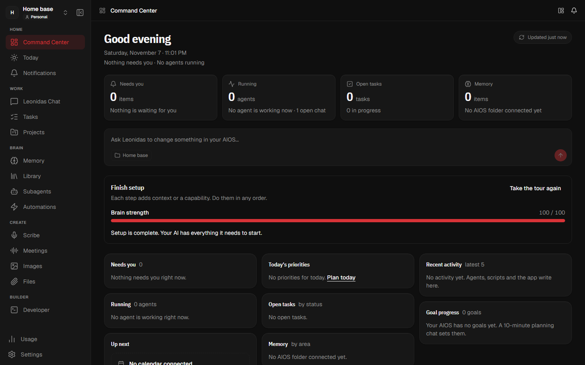
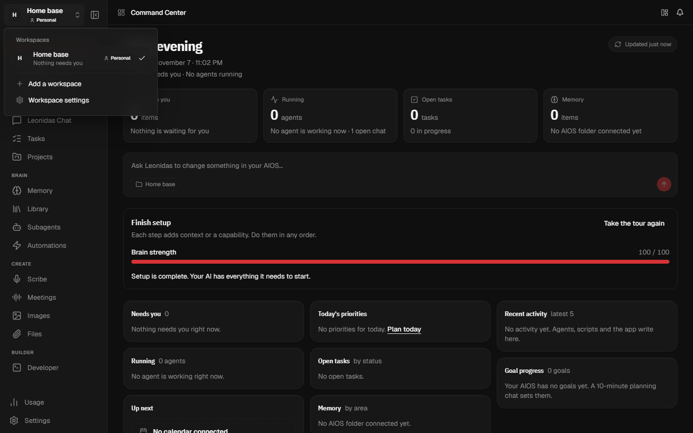
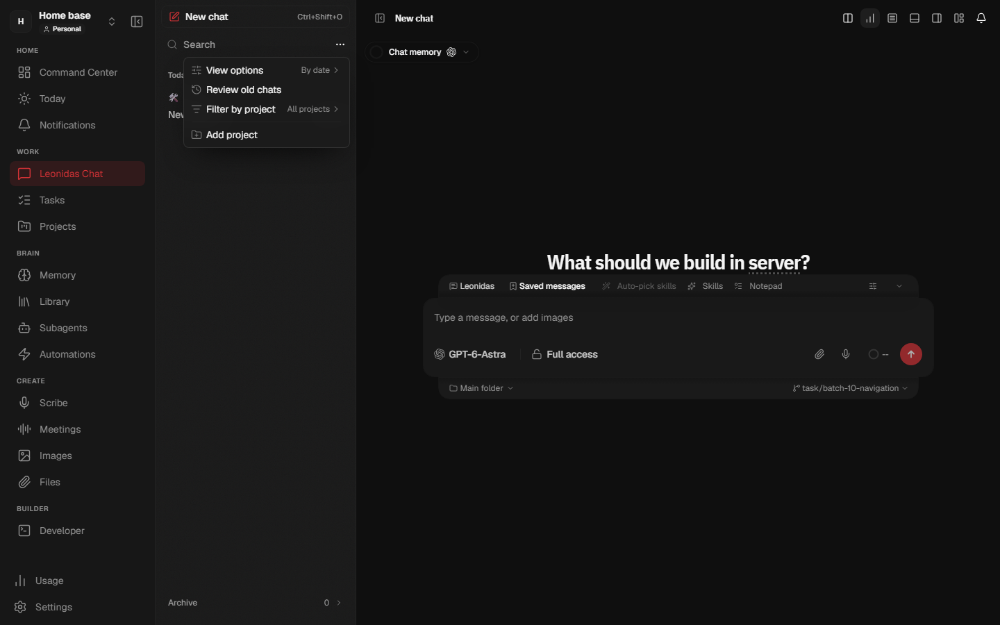

# Find every page by name

The menu on the left now shows a name for each page, sorted into groups. You can fold it back to icons when you want more room.

## Pages grouped by what you do

Pages sit under four groups: **Home**, **Work**, **Brain** and **Create**. Usage and Settings stay at the bottom. Every page stays one click away, with nothing hidden behind a fold. A business workspace adds a **Business** group.

To get more room, select the fold button next to your workspace name. The menu then shows icons only, with a thin line between groups. Select the button under your workspace picture to show the names again. Leonidas remembers your choice.

Three icons changed so they match their names: Scribe is a microphone, Meetings is a sound wave and Files is a paperclip.

## Switch workspaces from the top of the menu

Your workspace picture, name and type (Personal or Business) sit at the top of the menu. Select them to see your workspaces and switch between them. The open workspace shows how many items need you.

To change a workspace picture, point at the picture in that list and select it. **Add a workspace** and **Workspace settings** are in the same list.

## A simpler chat list header

**New chat** is now a full-width button at the top of the chat list. Below it are search and one **More** button. **More** holds View options, Review old chats, Filter by project and Add project, and shows the current view and filter.

