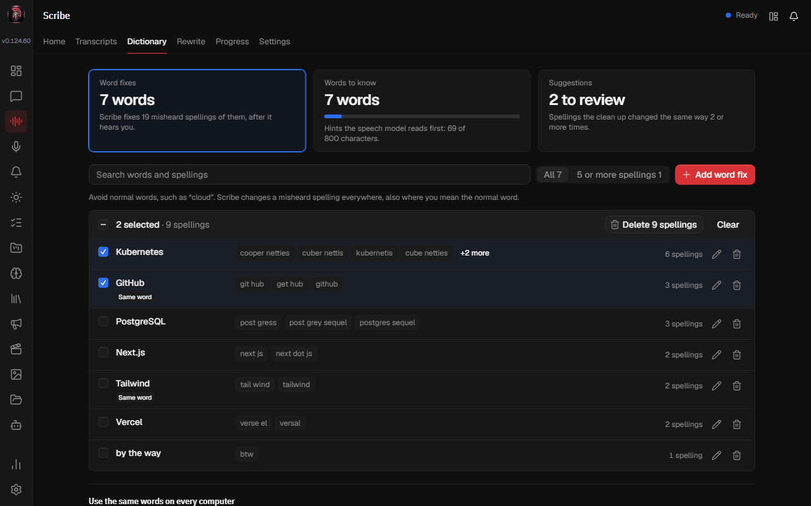
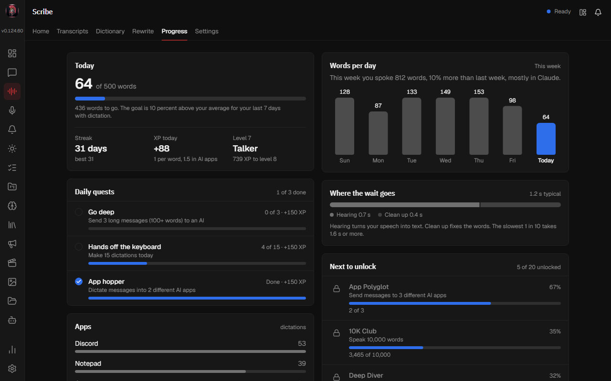

# Clean up your Scribe word list in one go

Scribe's tabs got a redesign. The Dictionary now counts real words, and Goals and Insights live together in one Progress tab.

## See which words Scribe fixes

Dictionary shows each right spelling once, with every misheard spelling Scribe changes into it. The card at the top tells you how many words that is, and how many spellings Scribe fixes for them.

Tick words to delete all their spellings at once. Undo shows for 6 seconds. Select the pencil on a word to remove one spelling or add another.

## Follow your day in one place

The new Progress tab shows today's words against your goal, your daily quests, the week, how long you wait for text, and the achievements you are closest to. It replaces Goals and Insights.

